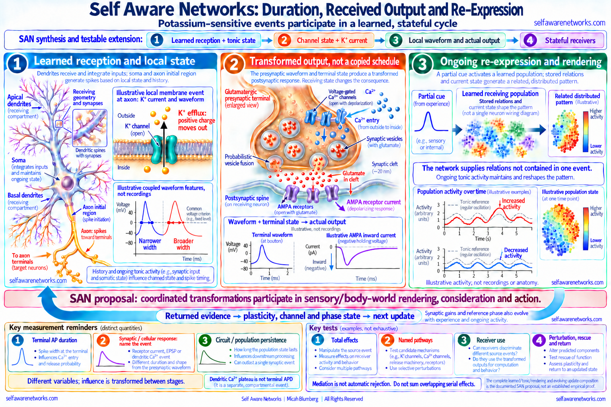

# Action-Potential Magnitude Via Duration

SAN's duration argument joins **learned receiving structure**, ongoing tonic
state, potassium-sensitive waveform duration, actual cellular output and
stateful receiving arrays. In the stronger account, their coordinated changes
participate in sensory/body-world rendering, consideration and action, while
returned evidence changes the next cycle. Duration is a central physical
variable in that proposed spiking operation, not a decorative extra added to
spike count. It is also not the only variable or a universal measure of meaning.

**Action Potential Magnitude Effect (APME)** is an early SAN name for this
question about the extent and character of a transmitted consequence. A
regenerative spike need not have an invariant waveform or consequence.
"Magnitude" must nevertheless name a quantity and stage: local voltage,
duration, calcium entry, release, receptor current and population response are
different physical variables, not interchangeable names for one number.



> **Figure scope:** Representative neuronal receiving anatomy and a conventional
> glutamatergic vesicle synapse, not every sensory-cell output or a reconstructed
> specimen. Local widths use a common voltage criterion, not necessarily
> half-amplitude. The AMPA-current illustration shows inward current at a
> negative holding voltage. All traces and population patterns are illustrative,
> not recordings or anatomical brain maps. The full tonic/rendering/return
> composition is SAN's proposal; supporting component experiments and models
> do not establish it all. Native biological and full-size reader review
> remain separate acceptance gates for these exact pixels.

## The complete operation

The source family proposes:

```text
prior experience and pre-existing structure constrain selective reception
-> current input meets learned receptors, morphology and tonic state
-> intracellular and ionic/channel conditions change
-> potassium-sensitive local duration and other waveform features change
-> actual output is transformed by local terminal and receiver conditions
-> learned arrays re-express a coordinated sensory/body-world pattern
-> consideration and action produce returned evidence
-> reception, plasticity and phase state change for the next update
```

The early notes do not stop at an external classifier detecting a wider
spike. Their positive claim concerns what receiving cells and arrays
physically register and transform, including how their collective operation
constitutes the experienced pattern itself. That constitutive joining is SAN
theory. Demonstrating an ionic or synaptic component is not by itself a
demonstration of the entire account of experience.

The tonic pattern is not an empty background to discard. The June and August
2022 sources describe an active expectation state that changes how a later
phasic event is received, while phasic events alter that ongoing state.
Both excitation and inhibition relative to the tonic pattern contribute.
The proposed effect is a receiver-relative differential, not excitation alone.

## What cellular evidence supports

### Terminal waveform and actual release

In small CNS terminals, potassium-channel properties and local voltage
waveforms help shape calcium entry and transmission-related output
([Hoppa et al., 2014](https://doi.org/10.1016/j.neuron.2014.09.038)). Work in
cultured excitatory hippocampal neurons also connects terminal potassium-
channel regulation, activity-dependent waveform broadening and facilitation
([Cho et al., 2020](https://doi.org/10.1073/pnas.2000790117)). These are
concrete component footholds, with preparation-specific coupled changes in
peak, width, conductances and output; they are not a universal
broader-means-stronger or width-only causal law.

At a conventional chemical synapse, terminal voltage affects calcium-channel
activation and calcium influx. Local calcium, release machinery and vesicle
availability contribute to probabilistic fusion. Transmitter and matched
receptors then produce a receiver response shaped by its own state. The
receiver does not receive a literal copy of the source voltage waveform or
a complete anatomical description of the source cell.

The source's suggestion of individual terminal modulation is substantive:
different branches and terminals can have different receiving targets and
local conditions. That does not establish arbitrary independent commands
from a soma to every bouton, or a fixed vesicle alphabet.

There is direct evidence for locally differentiated width: recordings from
cerebellar stellate-cell axons found different AP widths at bouton sites
even along one branch. Local Kv3-rich conductance hotspots and local channel
blockade supported near-synapse-by-synapse control of repolarization
([Rowan et al., 2016](https://doi.org/10.1016/j.neuron.2016.05.035)).
That measured compartmentalized control is a strong component foothold,
not proof of an arbitrary source command or a whole learned image in one spike.

### Waveform as recent history and local integration

Rat visual-cortex pyramidal neurons driven by naturalistic conductance
patterns produced somatic spike waveforms carrying reliable information
about input history for up to roughly 50 ms
([de Polavieja et al., 2005](https://doi.org/10.1523/JNEUROSCI.0242-05.2005)).
Waveform-dependent shunting also affects subsequent spike generation, and
the study models slow-conductance memory. This is a positive local function,
not merely a candidate message that matters only if it crosses a bouton.

A somatic history code is not automatically an identical terminal code,
learned object identity or conscious percept. Propagation and downstream
transformation remain parts of the proposed chain, not automatic scale jumps.
See [[action-potential-waveform]] and [[stimulus-history-and-action-potential-waveform]].

### Synaptic structure and multivesicular transmission

Holler and colleagues combined connected-cell slice physiology with
correlated microscopy in mouse somatosensory cortex. Synapse size related
to transmission strength, and quantal analysis supported multiple release
sites and multivesicular operation
([Holler et al., 2021](https://doi.org/10.1038/s41586-020-03134-2)). This
supports a structural/transmission component of the receiver problem. It is
not a study showing that APD chooses a universal count of zero, one, two or
three vesicles, nor proof of a duration-based memory code.

The older source's small vesicle counts are a proposed way to think about
differentiated output. Retain that operational question without converting
illustrative counts into universal biological symbols. Actual release is
stochastic, cell- and synapse-specific, and transformed by its recipient.

## Potassium, duration and different clocks

Potassium ions carry positive charge. Outward potassium current can help
repolarize a membrane by carrying positive charge out of the cell. A channel
is not a pump, and membrane conductance is not simply the total quantity of
potassium in a cell. Specify channel state, driving force, compartment and
recording conditions before interpreting a change in duration or frequency.

Three useful timescale families are:

1. **Presynaptic waveform:** a local AP half-width or another declared
   voltage-criterion duration, with peak, rise, repolarization and history.
2. **Synaptic and cellular receiving response:** calcium, fusion, transmitter
   clearance, receptor currents, dendritic voltage and any local regenerative
   event, each with its own duration. A receptor current and a dendritic
   calcium plateau are not the same measurement.
3. **Circuit or population state:** recurrent recruitment, inhibition,
   neuromodulation, plasticity and behaviorally relevant patterns that may
   last beyond the initiating event.

The source proposes influence through those stages, not an unchanged
duration copied between them. A short event can help recruit a longer-lived
state. Conversely, a longer local response need not yield persistent network
activity. These distinctions preserve the temporal translation question;
they do not replace the full reception and rendering operation.

### A dendritic duration mechanism is not bouton APD

The September 2022 source discusses dendritic calcium spikes alongside
axonal output. In a **compartmental layer-5 pyramidal-cell model**, timed
excitation could shorten a dendritic calcium spike, while inhibition could
lengthen or terminate it. Calcium and outward potassium currents controlled
the modeled plateau/termination dynamics and altered somatic output
([Dudai et al., 2022](https://pubmed.ncbi.nlm.nih.gov/34893549/)). This is
a concrete model of input/state-dependent duration. These simulations did
not record the complete sensory-to-bouton chain.

Preserve the source's positive input/coincidence/duration/output mechanism
without assuming that excitation always lengthens an event or inhibition
always shortens it. A dendritic calcium plateau, fast axonal AP and interval
between spikes must retain their own variables and metrics.

### A positive tonic-to-burst component

The August source identifies a nigral dopamine-cell study as central to its
reasoning. In vitro, NMDA activation recruited a calcium-activated
nonselective cation current, ICAN, capable of supporting plateau/bursting
activity; interventions targeting that mechanism suppressed bursting in that
preparation ([Mrejeru et al., 2011](https://doi.org/10.1113/jphysiol.2011.206631)).
This is a positive input/current/state-to-output foothold, not merely an
exception to a simplified neuron. Its plateau/burst mechanism is nevertheless
distinct from the width of a fast terminal AP or proof of the complete
rendering proposal.

The source's cardiac delayed-rectifier quotation supplies a separate
regulated-current/repolarization context
([cardiac review](https://doi.org/10.1016/j.ccep.2016.01.004)), not a neuronal
bouton experiment. Its Schwann/Fyn reference is retained as a source-supplied
archival citation whose identity is not yet independently resolved in this
packet; no replacement or claim of nonexistence is inferred.

The same source quotes a calcium-chelation manipulation using EGTA delivered
in potassium acetate, with acetate controls. Read it in that calcium/plasticity
context, not as a potassium-depletion experiment. The original experiment's
bibliographic and protocol verification remain separate from what this
archived quotation establishes. These preparations cannot be merged into
one universal potassium/APD experiment.

## Tonic expectation, glia and phase relations

In the June 2022 account, ongoing tonic group activity changes the conditions
under which a potassium/duration-related phasic event occurs. Glial
contributions to ion gradients, channel conditions and plasticity are part
of this proposed shared state. Interacting arrays can alter one another's
expectations and bring up new phasic patterns; the source's Tetris-afterimage
example illustrates persistent learned expectation, not a controlled test
of every step in that mechanism.

The September account adds **ongoing re-expression**: tonic transmissions
repeatedly express the selective active and inhibited relations of the
receiving network, maintaining a working pattern while phasic departures
reshape it. In that proposal, a learned pattern can remain present without
requiring a new external cue or a new phasic burst on every cycle. Inhibition
helps sculpt the experienced pattern rather than merely deleting information.
The proposed color example concerns a learned configuration of such relations,
not a universal frequency tag meaning red or blue.

Ongoing representation need not mean uninterrupted spiking in every cell.
In monkey prefrontal recordings, task-related reductions in variability
coexisted with intermittent, task-structured spiking and gamma bursts
([working-memory study, 2022](https://doi.org/10.1038/s41598-022-18577-y)).
That is a concrete temporal-organization component, not proof of SAN's full
rendering mechanism. Specify the population rhythm, intermittent recruitment
and synaptic/network state through which the proposed ongoing re-expression
is maintained.

A directly relevant neural-glial component has experimental support:
presynaptic potassium efflux and electrogenic glutamate transport contribute
to focal depolarization of mouse peripheral astrocyte processes, slowing
glutamate clearance and enhancing subsequent neuronal activation by glutamate
([Armbruster et al., 2022](https://doi.org/10.1038/s41593-022-01049-x)).
This is a positive state-dependent receiving mechanism, not proof that all
glia fire conventional neuronal APs or that the complete rendering identity
has been demonstrated.

The source also develops a tuning-and-routing proposal in dialogue with
[LaBerge and Kasevich's loop-circuit model](https://doi.org/10.3389/fnsys.2017.00037).
That theoretical work models dendritic resonance and potassium conductance,
with corticothalamic timing loops proposed to tune network participation.
It is not an experiment establishing that every neuron rejects all inputs
at a different frequency. Preserve the active proposal: current phase and
tuning conditions change effective receipt and propagation through learned
arrays, which changes which pattern is re-expressed.

Specify phase, frequency, coupling and time window separately. Frequency
change can alter phase over time, but a phase offset does not require a new
frequency. Nor is synchronization alone a sufficient rule for receptor
activation, transmitter sign or consciousness.

## From cellular durations to population spectra

For an aperiodic component fitted over a declared positive-frequency range,
one model is `P(f) = C f^(-beta)`, with declared normalization and parameters.
Oscillatory peaks require separate treatment. Power spectral density,
amplitude spectrum, event duration and physical energy are different quantities.

The positive cross-scale question remains: how might cellular waveform/current
and synaptic-duration distributions, geometry and coordinated activity
contribute to the population signal being measured? A declared forward model,
measurement geometry and simultaneous relevant-scale observations can test
that proposed translation. The fitted spectrum is not by itself an inverse
law between one spike's peak and width or proof of a universal duration code.
See [[stimulus-history-and-action-potential-waveform]] for its more detailed
source-specific scale question.

## Learned geometry and network re-expression

The September source connects selective dendritic/synaptic configuration,
coincident input, local regenerative events and differentiated output.
Its intended two-sided learning operation is that a cell's response and
feedback become part of what its receiving structure can learn to anticipate.
Basal and apical dendrites are receiving compartments; the conventional
output arbor is axonal. Back-propagation within a cell, retrograde chemical
regulation across a synapse and recurrent circuit feedback are distinct
physical routes, not one voltage jumping backwards through a chemical cleft.

The source's local-regulation question has a useful measured counterpart:
in hippocampal slice experiments and a related model, endocannabinoid-linked
suppression of excitation and astrocyte-mediated potentiation were detectable
at single or few synapses but could be concealed in bulk recordings
([synapse-specific study, 2017](https://doi.org/10.3389/fncel.2017.00367)).
This is not an APD-memory experiment. It supports pairing local, identified
synapse measurements with population observations, rather than treating an
aggregate null as sufficient evidence that no relevant local operation exists.

The stronger network proposal is:

```text
partial cue and history-dependent output
-> transformed effects at learned receivers
-> coordinated recruitment of relations held in network structure/state
-> a newly generated distributed pattern
-> experienced sensory/body-world rendering, consideration and action
-> returned evidence and changed future reception
```

A finite event need not contain every detail supplied by that learned
network. Re-expression is not literal replay of a stored APD schedule, but
neither is it merely an outside observer classifying a spike. In SAN's
constitutive proposal, the coordinated receiving transformations participate
in the experienced pattern itself. No second viewer inside a neuron is
needed by that account.

In the source's memory account, future reception and output can change
through receptor configuration, spines and morphology, release machinery,
intrinsic state, gene/protein-dependent plasticity and network relations.
Longer-term memory is not stored as one APD value. The proposal joins those
learned constraints to their current re-expression, rather than claiming
that one finite spike contains every learned relation.

Experimental memory work supports specific components of this larger
operation: CA3-pyramidal NMDA-receptor deletion can impair partial-cue recall
([Nakazawa et al., 2002](https://doi.org/10.1126/science.1071795)); tagged
dentate-gyrus ensemble reactivation can evoke context-linked freezing in
mice ([Liu et al., 2012](https://doi.org/10.1038/nature11028)); and mapping
and manipulation support a distributed engram complex
([Roy et al., 2022](https://doi.org/10.1038/s41467-022-29384-4)). These are
not measurements of APD as a sole retrieval key or of complete experienced
content. See [[action-potential-waveform-encoding]] and [[oscillation-memory-reinstatement]].

## Physical-valued events and an evolving update

In the named 2024 dialogue, Micah clarifies that the proposal is **physical
analog computation**, not merely a verbal similarity to a loss function.
The physical difference from a prior tonic pattern supplies numerical
coordinates of the proposed calculation; transmission and interaction
change the receiving state and can reduce or absorb that difference into
an updated pattern. This is a proposed embodied difference/update operator.

He also rejects the chatbot's assumption that analog computation must erase
bounded events. A transmission can have a beginning, waveform and ending
while its physical amplitude or duration varies. Event boundaries and a
mathematically quantized value alphabet are different issues. The source
does not license replacing its event-based physical argument with a
continuous-only abstraction or an invariant binary pulse.

The source also allows an artificial implementation of the relevant
computational organization. Its argument is about preserving the operative
receiving/state/output relationships, not a categorical ban on digital models.

To formalize the derivative-like or loss-related account, define the
represented variables, reference state, observation interval, units,
coupling and update rule. A finite difference is not automatically a
derivative or a proved gradient-descent mechanism. Likewise, voltage-times-
duration is not automatically energy, and a population power spectrum is
not a single spike's width. Preserve the intended physical computation
without declaring an undefined product or inverse-frequency relation a
universal law. See [[phase-wave-differential]] and [[phase-wave-differential-calculus]].

The later mixed/compiled 2025 source adds a specific endogenous update:
recent timing and current duration, structural gains/losses and a reference
phase influence the next duration, while those structural and phase
variables themselves evolve with coincidence and network activity. This
retains a coupled multi-timescale mechanism, not only a scalar CV label.
CV is one suggested summary, not the whole ordered signed signal or a
universally measured APD/consciousness controller. Do not attribute every
compiled assertion to Micah or backdate that later model into earlier notes.

## Sensory surfaces and the received difference

The taste/hearing source explicitly links selective receptor input and
intracellular signaling to potassium/channel conditions, duration and
differentiated output. The whisker literature shows state-dependent cortical
reception ([Crochet and Petersen, 2006](https://doi.org/10.1038/nn1690)),
not by itself a universal recognition-by-broadening result.

Choose the actual sensory cell and spiking stage. Type-II taste cells use
CALHM1/3 ATP-channel output rather than the conventional Cav/vesicle route
([Ma et al., 2018](https://doi.org/10.1016/j.neuron.2018.03.043)).
Hair-cell mechanical transduction is distinct from a later auditory-neuron
APD test.

There is also direct peripheral potassium/duration evidence: patch-clamp
work in dissociated posterior rat taste cells found that potassium-current
blockers broadened APs, with larger outward currents associated with shorter
half-widths ([1996 taste-cell study](https://doi.org/10.1152/jn.1996.75.2.820)).
Those cells were not thereby identified as the modern CALHM type-II population
or as umami-recognition events; ATP output and experienced taste were not
simultaneously established by that experiment. The positive K/APD component
and the distinct output-route evidence can be joined as a declared research
bridge, not treated as one already completed experiment.

Recognition and surprise are input/history/state relations, not synonyms
for broader spikes. The full positive potassium/APD question is retained at
an identified stage. See [[stimulus-history-and-action-potential-waveform]]
and [[umami-multi-receptor-coincidence-detection]].

## Decisive tests without erasing the mechanism

1. **Define the physical event and recipient.** Record the named compartment,
   potassium current/conductance where relevant, complete waveform and a
   declared duration metric. Measure actual output and the receiver's state,
   not only an external decoder's score.
2. **Separate total effects and pathways.** Test whether a feasible waveform/
   channel intervention changes transmission and later receiver/behavioral
   consequences. Calcium, release and receptor currents may mediate that
   effect. Conditioning on all of them can remove an upstream residual
   without removing its total contribution. Serial pathways need a defined
   causal decomposition, not an automatic sum of overlapping stage effects.
3. **Test selective use and re-expression.** Compare matched alternatives,
   perturbation and rescue, learned versus novel conditions, and whether
   receivers use the transmitted distinction to change the predicted pattern
   or action. Match nuisance exposures and fitting resources without
   conditioning away the mechanism being tested.
4. **Test return and evolving state.** Measure how returned evidence changes
   reception, plasticity, phase and later output. For a proposed coupled
   controller, compare equal-CV histories with different order or phase and
   perturb the named local or reference-phase route.

A potassium-channel intervention is not automatically a duration-only
intervention. Declare preparation, spike train, compartment and width
criterion; monitor coupled peak, rise, repolarization, excitability and
propagation changes. A width-isolation claim needs appropriate waveform
control, matched alternatives and rescue, with the receiver outcome specified.

For the coupled-state model, declare whether a statistic describes durations,
interspike intervals or another ordered history, and define its units,
windows, wrapped relative phase and update latency. Equal scalar CV does
not fix temporal order or phase. These are implementation-specific model
requirements, not reasons to erase the positive evolving-state operation.

These are proposed studies, not completed confirmation of the entire SAN
account. A null selective effect or a sufficient matched alternative can
constrain a specified implementation under declared conditions. Fully
mediated transmission is not automatically a failure of the duration
contribution, and a local success is not proof of experience's identity.

Declare the target time and available observations. Completed APD may be
unavailable before early calcium or release begins. Use an eligible waveform
prefix for an early prediction and completed consequences as history for a
later update; do not use an outcome to predict itself.

## Source genealogy and custody

These are fixed Git snapshots, not automatically first-public-availability
dates. The internally dated objection, remembered origins, composition,
platform custody, Git metadata and later compilation remain distinct.

| Snapshot | Positive source contribution | Context and evidence class |
| --- | --- | --- |
| [June 8, 2022: a0053z ctpr](https://github.com/v5ma/selfawarenetworks/blob/7d1431213cd4ac9788848a5396ec2992ece11cfd/a0053z%20ctpr.txt) | Variable downstream influence, slowing and spread between oscillatory groups. | Exploratory receiving-network proposal, not a fixed vesicle/sign rule. |
| [June 27, 2022: a0206z](https://github.com/v5ma/selfawarenetworks/blob/27a9f198d7f664d0a4b6edf6a08b7732331af110/a0206z.md) | Tonic expectation changes potassium/duration conditions; glia, learned geometry and recurring imagery contribute to rendering. | Source synthesis, not a universal potassium-quantity controller or a measured afterimage mechanism. |
| [August 3, 2022: a0053z](https://github.com/v5ma/selfawarenetworks/blob/b79351a4fe3667296952c483e6beb68732bf3865/a0053z.md) | Duration, calcium/release, spatial effect and relaxation into tonic activity are joined. | Named cell, transmitter, receiver and probabilistic output remain necessary. |
| [August 10, 2022: a0272z](https://github.com/v5ma/selfawarenetworks/blob/75b194fb97d2da09fb8bdd4130be98b910a72adb/a0272z.md) | Sensory reception and intracellular modulation feed the potassium/duration/output proposal. | Different receptor cells and signaling routes are not one conventional bouton. |
| [August 19, 2022: a0053z](https://github.com/v5ma/selfawarenetworks/blob/faf361d9790ae26de3e90d923e74e9a8755e186b/a0053z.md) | Tonic attractors, inhibited/excited departures, regulated potassium channels and receiving arrays participate in experienced rendering. | Quoted cardiac, glial, neuronal and modeling preparations remain distinct. |
| [September 8, 2022: a0007z](https://github.com/v5ma/selfawarenetworks/blob/26dddd6ff9be0e9460686611f7622cb7873d011a/a0007z.md) | Learned coincidence, local modulation, recurrent tuning and sparse network re-expression; both active and inhibited relations shape the proposed experienced pattern. | Dendrites, axonal terminals, intracellular back-propagation, retrograde signaling and loop-model hypotheses are not interchangeable anatomy or evidence. |
| [September 6, 2024: 02san](https://github.com/v5ma/selfawarenetworks/blob/df4d7f8d3270d56de167035c4987c3e072696c79/02san.md) | Micah specifies physically valued tonic-relative differences and bounded transmissions as part of an analog calculation/update. | Named dialogue distinguishes his corrections from GPT elaborations; neither chatbot agreement nor an undeclared inverse law is independent validation. |
| [June 16, 2025: 13san](https://github.com/v5ma/selfawarenetworks/blob/172e778a01b06357e5921d772f8ff18f9818a7d3/13san.md) | Coupled duration, synaptic and reference-phase state update across timescales. | Mixed/compiled later model, not every sentence identified as Micah or a completed biological/computability proof. |

The separate [a0263z objection](https://github.com/v5ma/selfawarenetworks/blob/5af8b6aa029594d221ad72c9e0a5ce2ed2ab3a98/a0263z.md)
is internally dated February 14, 2014 and Git-fixed June 11, 2022. Its
speaker is unsigned. Membrane voltage and compartment-dependent
back-propagation must be distinguished from a supposed axonal maximum, but
course-model identical spikes are not blanket biological authority. Do not
attribute the adversary's words to Micah or accept the entire passage as
anatomy. The original source question is the learned pattern-to-output and
receiving operation, not a requirement for excess voltage beyond a universal
ceiling.

The [[san-book2-bridge-atlas|Book and Bridge Atlas]] can connect later
explanations as read-only donors. Their inclusion does not certify a source,
speaker, earliest date or the complete scientific account.

## Related concepts

- [[action-potential-duration]]
- [[action-potential-magnitude]]
- [[action-potential-waveform]]
- [[stimulus-history-and-action-potential-waveform]]
- [[multi-vesicular-release]]
- [[synaptic-unreliability]]
- [[oscillation-memory-reinstatement]]
- [[napot-overview|NAPOT]]
- [[early-a0255-a0276-obscure-argument-map|Early a0255-a0276 Obscure Argument Map]]
- [[potassium-channel-modulation]]
- [[action-potential-waveform-encoding]]
- [[phase-wave-differential]]
- [[phase-wave-differential-calculus]]
- [[cellular-oscillating-tomography]]
- [[umami-multi-receptor-coincidence-detection]]
- [[san-book2-bridge-atlas]]

