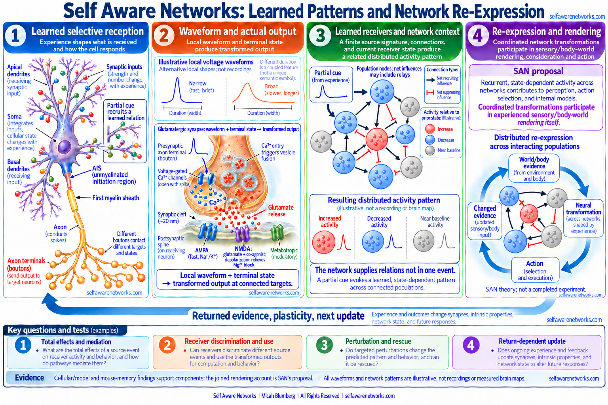

# Action-Potential Waveform Encoding

The historical SAN proposal joins **learned selective reception**, a neuron's
actual output, and the learned network that receives it. A later cue can recruit
a source whose structure and state have been changed by experience; its output
can then help select a related population trajectory. The receiving network
contributes its own stored relations and present state. The source event need
not contain a lossless photograph of its originating cell or every detail of
the later population state.

Waveform encoding is one part of that operation: can differences in a local
spike or burst affect a receiver's discrimination and subsequent use? The
larger proposal concerns **sparse structural compression and network-assisted
re-expression**, including the continuing sensory and bodily rendering
experienced by an organism. A waveform classifier or a memory-retrieval
experiment can test a component without replacing that complete argument.



> **Figure scope:** The representative cortical neuron and glutamatergic
> synapse are schematic, not anatomical scale. The unmyelinated AIS is distinct
> from the first myelin sheath. Local voltage contrasts and population patterns
> are illustrative, not recordings or measured brain maps. The graphs use
> population nodes and net influences that may include intervening cells, not
> single neurons with mixed direct output-synapse types. Red marks increased
> activity, blue decreased activity and gray near-baseline activity relative to
> prior state; recruiting/suppressing influences have a separate legend.
> Postsynaptic NMDA
> ligand/co-agonist conditions differ from voltage-dependent magnesium block.
> The right panel states SAN's positive constitutive rendering and feedback
> proposal, not a completed experiment or a hidden viewer. Component studies
> do not alone establish that whole operation. See [[action-potential-waveform]]
> for the local compartment and synapse explanation.

The AIS and mediated-inhibition distinctions have specific cellular examples
([Palmer and Stuart, 2006](https://doi.org/10.1523/JNEUROSCI.4812-05.2006);
[Silberberg and Markram, 2007](https://doi.org/10.1016/j.neuron.2007.02.012)).
The population graphs here are illustrative, not reproductions of those experiments.

## The source operation

Learning can change connections, receptor distributions, dendritic structure,
intrinsic excitability and the state in which later input is received. The
SAN sources propose that those changes select particular input relations and
shape a finite, differentiated output. Learned receivers do not need to infer
the source cell's complete anatomy before using that output.

```text
experience changes selective cellular and network structure/state
-> a present cue recruits a learned relation
-> cellular transformation shapes an event and actual local output
-> differentiated terminals and stateful receivers transform it again
-> recurrent recruitment re-expresses a related distributed pattern
-> sensory/body-world rendering, consideration or action
-> returned evidence changes reception and the next update
```

The early "transmitting their shape" formulation connects learned structure
to its signal consequences. Its sparse-message clarification distinguishes
the represented relation from the finite message that helps recruit it.
An index can retrieve something larger because the rest is supplied by a
structured system, not because the index contains the whole retrieved object.
That analogy describes the proposed operation; it is not a measured capacity
theorem or an instruction to replace the biological network with a static key.

The [[gh-a0001z|August 2022 source]] also proposes finer, individually modulated
synaptic output and a constitutive role in rendered perception. The question
is not merely whether different boutons have different fixed properties.
Learning and present input must change a particular output pattern and its
subsequent use. Feasible local mechanisms and target relations matter;
arbitrary statistically independent commands from the soma to every bouton
are not a prerequisite.

## What cellular experiments and models support

A somatic waveform is not automatically the waveform at every branch or
bouton. Local conductances, geometry and recent activity can transform it.
In named preparations, terminal waveform changes affect calcium entry and
synaptic transmission ([Hoppa et al., 2014](https://doi.org/10.1016/j.neuron.2014.09.038);
[Cho et al., 2020](https://doi.org/10.1073/pnas.2000790117)). These findings
do not establish a universal broader-means-stronger law or show that every
learned sensory relation has its own unique spike shape.

In **compartmental models** of reconstructed neocortical neurons, different
dendritic geometries produced different firing patterns despite a common
ion-channel distribution ([Mainen and Sejnowski, 1996](https://doi.org/10.1038/382363a0)).
This supports a structure-to-transformation premise within that model. It is
not an experiment showing lossless anatomical decoding from a recorded spike.

At a conventional chemical synapse the relevant route includes:

```text
terminal voltage -> local calcium -> probabilistic fusion
-> transmitter time course -> matched receptors and receiver state
-> electrical, chemical, timing or plasticity consequence
```

The receiver encounters a transformed consequence, not the presynaptic voltage
trace copied across the cleft. Different receptor, terminal and receiver
conditions can change the consequence of the same source event. See
[[contextualized-spike-receiver-relative-transformation]].

## What memory experiments support

The network-assisted part has several specific experimental footholds:

- **Partial cues:** Adult mice with CA3-pyramidal-cell NMDA receptors deleted
  could acquire and retrieve a spatial memory with full cues but were impaired
  when only some cues remained. The result supports a CA3 receptor/circuit
  contribution to associative recall, not a measured waveform key
  ([Nakazawa et al., 2002](https://doi.org/10.1126/science.1071795)).
- **Learned ensemble reactivation:** Optogenetically reactivating dentate-gyrus
  neurons tagged during fear learning produced context-specific freezing in
  mice, with the reported control conditions. This tests a sparse learned
  ensemble's sufficiency for that behavioral expression, not the complete
  experienced content or a universal waveform code
  ([Liu et al., 2012](https://doi.org/10.1038/nature11028)).
- **Distributed memory relations:** Brain-wide mapping and manipulation in
  mice supported a functionally connected complex of engram ensembles for
  contextual fear memory; reactivating multiple ensembles increased recall
  relative to a single ensemble. This is a distributed memory result, not
  evidence that one cell contains a whole brain state
  ([Roy et al., 2022](https://doi.org/10.1038/s41467-022-29384-4)).
- **One-to-many influence:** Patch-clamp stimulation with two-photon calcium
  imaging in mouse V1 found few reliable individual followers but a weak,
  distributed aggregate population effect. The preparation and measurement
  matter; this is not instantaneous global recruitment by every neuron
  ([Meyer, Golshani and Smirnakis, 2018](https://doi.org/10.3389/fncir.2018.00029)).

Together these findings make selective recruitment, partial-cue recall and
distributed reactivation concrete operations to investigate. They do not
identify waveform shape as the sole retrieval variable or establish the
complete SAN constitutive rendering proposal.

## A receiver-used event signature

A proposed event signature may include local waveform, timing, burst position,
terminal participation and actual release outcomes. Its coordinates are
coupled; source history and terminal identity are context, not additional
independent voltage channels. An analytic record could use:

`U_e = F(S_source, I_e, H_e, C_terminal)` **[1]**

This is a declared model, not a measured universal cellular equation. If `F`
predicts a conditional distribution or mean, distinguish that prediction from
the realized event, including fusion variability and unmeasured state.

For a receiver:

`Y_r = G_r(U_e, C_receiver, H_receiver)` **[2]**

The question is which transformed alternatives the receiver discriminates and
uses. A receiver need not uniquely reconstruct every original waveform
coordinate or the full source morphology. An external decoder's success alone
does not show that the organism uses the same distinction.

For network re-expression, a prospective update can be written:

`R_(t+1) = H(R_t, U_e, K_learned, C_network)` **[3]**

Here learned connectivity and present population/receiver state supply
relations not contained in `U_e` alone. Declare whether `H` predicts an actual
state, distribution or summary. This notation is not an experimentally
established controller. The related later-source tensor representation also
does not demonstrate that cells symbolically compute tensor or Taylor algebra.
The September 2022 source permits virtual branches when their changing
selectivity and output operations are preserved; it is not a categorical ban
on digital simulation.

## Tests that preserve the full proposal

Distinguish four questions without making one residual score decide all four:

1. **Discrimination:** Does a declared receiver distinguish the relevant
   transformed event alternatives under held-out conditions?
2. **Transmission and mechanism:** Does a feasible source/channel/waveform
   intervention change the predicted receiver pattern? Declare the exposure,
   causal graph, alternative routes and assumptions. A channel manipulation
   need not change width alone.
3. **Organismal use:** Does the receiver change affect a learned relation,
   reconstruction, decision or action? Include target-specific perturbation
   and rescue, not merely external classification.
4. **Return and re-expression:** Does the cue/output/receiver relation select
   a related population trajectory and does returned evidence alter the next
   update? Compare capacity- and information-matched alternatives and ordinary
   ensemble recruitment, without deleting the proposed learned operation.

Calcium, release and receptor currents can mediate a transmitted waveform
effect. Conditioning on them can remove an upstream residual even when the
organism uses the transmitted difference. Separate the **total effect**,
mediation, incremental predictive value and receiver use. A failed estimator
or a null residual after a mediator is not a universal rejection criterion.
Likewise, a positive component result is not proof of experience's identity.

Specify the available observations, event window, target time, baseline,
fitting resources and held-out references. Completed spike width may only be
known after the earliest calcium or release event begins. Use an available
waveform prefix for an earlier target and completed consequences as history
for later updates; do not use the outcome to predict itself. Adding a
deterministic feature to its complete waveform cannot create new information,
though a finite estimator may benefit from that representation.

An extracellular recording also requires its own measurement model. Electrode
position, source geometry, tissue conductivity and filtering influence the
signal; sorted extracellular waveforms do not directly measure every bouton's
voltage or vesicle outcome ([Buzsaki, Anastassiou and Koch, 2012](https://doi.org/10.1038/nrn3241)).

## Resonance, perception and return

The preserved `a0091z` conversation connects content-addressable relations,
receiver-selective propagation, changing wave patterns, visual appearance,
and the question of what physically receives those signals. It also describes
mirror and EEG/audio-visual feedback as cycles in which output changes later
input and self-awareness. Those positive perception/return operations must
not disappear when the pitchfork/Tesla-coil analogy is translated into a
testable biological account.

The intrinsic electrophysiology review by
[Llinas (1988)](https://pubmed.ncbi.nlm.nih.gov/3059497/) describes how
conductances can support autorhythmic activity and frequency-selective
resonant responses. It supports a bounded cellular selectivity framework,
not passive amplification of a free electromagnetic message at every synapse.
Transmitter/receptor and cellular conditions determine excitation or
inhibition; coherence/decoherence alone is not a universal cell-type label.

The same historical export contains Micah's owner-dated late-April proposal
of a **two-way field/cell operation**. Neural chemical changes are proposed
to register particle or field conditions, while cell activity and energy/
entropy export alter the surrounding field. The source calls this a
quantum-field/cell interface and explicitly includes both neurons and glia.
The later August 2022 rendering account likewise names a neural-glial network.
These are positive source proposals, not merely a label for an unspecified
alternative or evidence supplied by the memory experiments above.

Keep that branch distinct from the earlier March description of thought as
spatiotemporal pattern rather than its material carriers, with EEG brainwaves
proposed as possible residual/dissipative indicators. The different source
formulations are not one settled carrier mechanism. Chase's suggested
entanglement explanations and participants' personal experiences also retain
their own voices and evidence classes, rather than all becoming Micah's
measured findings or clinical instructions.

A discriminating field/cell study would need a defined physical variable,
coupling, timescale and intervention, with matched conventional synaptic and
volume-conducted recording alternatives. The cited cellular and memory studies
test their named component operations, not this proposed field/glial loop.
Preserving that distinction leaves the stronger SAN proposal explicit: learned,
physically realized, recurring transformations participate in rendering, action
and returned evidence, without a hidden viewer watching the pattern.

## Source genealogy and custody

- **September 19, 2012 platform record:** The
  [archived shape/program post](https://x.com/i/web/status/248495906763177984)
  fixes the theory title and original published-document link. An owner-held
  discussion PDF supplies named comments and a sparse-message clarification;
  its embedded creation date is not immutable proof of every sentence's public
  availability. Micah and other named participants are not automatically one
  author.
- **Owner-dated 2014 dialogue; Git-fixed June 8, 2022:**
  [a0091z](https://github.com/v5ma/selfawarenetworks/blob/37da575ba33f85cef4239295be161066d8d39f4c/a0091z.md)
  preserves Micah/Chase turns about selective propagation, learned relations,
  perception and feedback. The export explicitly reports deletions from a
  longer conversation. Its note-service header and message dates have distinct
  scopes; neither fixes public availability on those original dates.
- **Owner-estimated 2014 or earlier; Git-fixed June 10, 2022:**
  [a0008z](https://github.com/v5ma/selfawarenetworks/blob/0e73da1a76427937a8203c2fa9e1306c3114505e/a0008z.md)
  joins learned structure, sparse transmission and subsequent network
  recruitment. The remembered date does not override the separate 2012 title
  record or date every later mechanism to 2012.
- **August-September 2022 repository snapshots:**
  [a0053z](https://github.com/v5ma/selfawarenetworks/blob/b79351a4fe3667296952c483e6beb68732bf3865/a0053z.md),
  [a0001z](https://github.com/v5ma/selfawarenetworks/blob/db4349ddbcc74fa19a2fa564e60dc86f9aca97a8/a0001z.md),
  and [a0008z](https://github.com/v5ma/selfawarenetworks/blob/16b087dcf8a28d55ba32b45c40c342f81744a354/a0008z.md)
  develop burst/spread, output resolution, constitutive rendering and
  multidimensional event proposals. Preserve each body's actual contribution;
  do not assign the wider family's complete potassium/APD mechanism to every
  earlier note or backdate the later names.

The [[san-book2-bridge-atlas|Book and Bridge Atlas]] can supply later
explanations, not blanket original-source, speaker or scientific authority.

## Related concepts

- [[action-potential-waveform]]
- [[action-potential-duration]]
- [[information-theory-in-spiking]]
- [[multi-vesicular-release]]
- [[engram|memory engrams]]
- [[pattern-completion]]
- [[oscillation-memory-reinstatement]]
- [[tonic-phasic-phase-wave-differential]]
- [[phase-language-firewall]]
- [[napot-overview|NAPOT]]
- [[stimulus-history-and-action-potential-waveform]]
- [[receptive-inceptive-dendritic-projection]]
- [[san-book2-bridge-atlas]]
