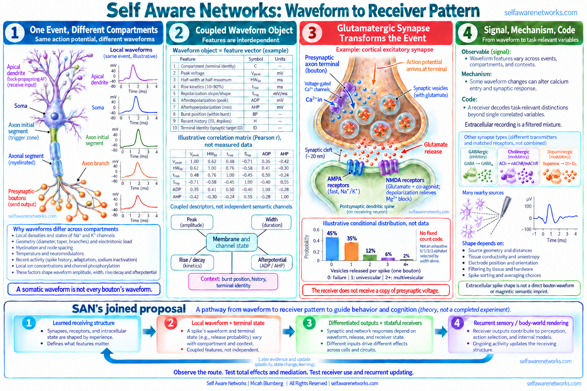

# Action Potential Waveform

An **action-potential waveform** is the membrane-voltage trajectory of a spike at a specified
recording location. Rise time, peak voltage, width, repolarization, afterdepolarization, and
afterhyperpolarization are measurable features. They are coupled consequences of conductances,
geometry, compartment, and recent history, not a universal set of independently readable symbols.

The source-faithful SAN question is nevertheless substantive: what information about a cell's
recent input and learned state can survive in a compartment-specific waveform, how is that event
transformed at different boutons and synapses, and can the resulting **pattern of receiver
consequences** improve prediction of the next population state?

The complete proposal extends beyond prediction of that next state. Micah connects learned
receiving structure, present input, local electrical transformation, differentiated outputs,
stateful receivers and the recurring sensory/body-world rendering experienced by an organism.
The waveform is one event in that joined operation, not a replacement for it.

> **Evidence and proposal:** Waveform variation can carry recent-history information in specified
> preparations and change calcium entry or transmission. A chemical synapse does not pass the
> source voltage trace intact. SAN proposes that transformed receiver-relative patterns participate
> in a learned, recurrent rendering of experience. Local physiology, that documented synthesis,
> its constitutive extension and tests of the joined account are different evidence classes.



> **Figure scope:** The representative pyramidal-cell compartments and conventional glutamatergic
> synapse are schematic, not anatomical scale. Local traces, the Pearson correlation matrix and
> release-count probabilities are illustrative, not recordings. Apical back-propagation is not
> axonal output. AMPA/NMDA receptors are on the receiver, and NMDA's ligand/co-agonist conditions
> are distinct from its voltage-dependent magnesium block. Zero released vesicles is failure,
> one is univesicular and every count of two or more is multivesicular, per one spike at the
> declared bouton. The lower band is the positive SAN proposal, not a completed experiment.

## A waveform is compartment-specific

The familiar textbook spike is a useful schematic, not one waveform shared by the whole neuron.
The soma, axon initial segment, axonal branches and
boutons can have different amplitudes and durations. A fast axonal spike can also back-propagate
into apical dendrites in studied pyramidal cells; that is not a dendrite functioning as an axonal
exit terminal ([Stuart and Sakmann, 1994](https://doi.org/10.1038/367069a0)). Sodium- and potassium-channel distributions,
morphology, myelination, recent firing, temperature, and modulators all influence the local trace.

Somatic state can affect axonal and presynaptic waveforms, while local axonal conductances and
geometry continue to transform them. See [Shu et al. (2006)](https://doi.org/10.1038/nature04720),
[Foust et al. (2011)](https://doi.org/10.1523/JNEUROSCI.2752-11.2011), and
[Hoppa et al. (2014)](https://doi.org/10.1016/j.neuron.2014.09.038).

This does not mean that rise time, peak, area, width, slope, and afterhyperpolarization are
independent channels. They covary because the same conductances and geometry help generate them. A
valid encoding analysis must account for that covariance and must not substitute a somatic
waveform for the trace at an identified bouton.

## Recent input history can survive in waveform shape

The all-or-none description remains useful for regenerative spike initiation. It does not imply
that every spike waveform is identical or informationally equivalent.

In rat cortical pyramidal neurons driven by naturalistic conductance patterns, somatic waveform
height and width reliably signaled aspects of the preceding input history for up to about 50 ms.
In that preparation, the waveform carried more information about the stimulus history than an
instantaneous-rate description. See
[de Polavieja et al. (2005)](https://doi.org/10.1523/JNEUROSCI.0242-05.2005).

That result establishes a bounded cellular code in a particular preparation. It does not show that
every learned sensory feature has a unique waveform, that the soma specifies every terminal
consequence, or that waveform variation by itself produces a rendered percept.

## What crosses a chemical synapse

The presynaptic voltage waveform opens terminal calcium channels and changes the electrical driving
force for calcium entry. Local calcium then interacts with active-zone and release machinery to
change a probability distribution over vesicle fusion. Transmitter crosses the cleft, is cleared or
taken up over time, and acts through the receptors and membrane state of a declared receiver. The
receiving cell does not receive a copy of the presynaptic voltage waveform.

```text
state-dependent terminal voltage
-> local calcium entry
-> probabilistic zero, one, or multivesicular release at a declared bouton
-> transmitter time course in the cleft
-> receptor, membrane, and biochemical transformation in a declared receiver
-> electrical, chemical, timing, or plasticity consequence
```

Every arrow depends on preparation, synapse type, active-zone geometry, recent activity, release
machinery, receptor composition, and receiver state. The steep and spatially local calcium
dependence of release makes waveform changes consequential, but prevents a universal one-to-one
mapping from waveform width to transmitter amount. This component chain has been measured in named
preparations: waveform changes altered calcium entry and synaptic strength at rat cerebellar
granule-cell to Purkinje-cell synapses
([Sabatini and Regehr 1997](https://doi.org/10.1523/JNEUROSCI.17-10-03425.1997)); action-potential
duration modulated calcium entry and transmitter release at rat hippocampal CA3-CA1 synapses
([Qian and Saggau 1999](https://doi.org/10.1152/jn.1999.81.1.288)); and voltage, calcium, release,
cleft kinetics, and receiver state were separately resolved in other preparation-specific work
([Mayer et al. 1984](https://doi.org/10.1038/309261a0);
[Clements et al. 1992](https://doi.org/10.1126/science.1359647);
[Hoppa et al. 2014](https://doi.org/10.1016/j.neuron.2014.09.038);
[Cho et al. 2020](https://doi.org/10.1073/pnas.2000790117)).

## One source event can produce a distributed output pattern

Source-faithful recovery changes the object of interest. The early SAN proposal was not only about
one waveform being decoded by one receiver. It asked whether a neuron's learned and recent state
could be expressed through a patterned one-to-many output.

Established physiology supplies a foothold without proving the SAN composition. In young rat
neocortical pyramidal cells, one action potential reliably reached boutons across the axonal arbor,
yet action-potential-evoked calcium transients varied substantially among boutons, including
boutons on the same axon. See
[Koester and Sakmann (2000)](https://pubmed.ncbi.nlm.nih.gov/11118494/). Active-zone structure,
target identity, local modulation, release machinery, and receiver receptors can further diversify
the consequences.

The medically bounded joined route is:

```text
learned receptive structure + present spatial/temporal input
-> graded dendritic, somatic, and axonal state
-> thresholded regenerative event or burst
-> state-dependent axonal and terminal waveform
-> terminal calcium entry and local release machinery
-> probabilistic release outcome at a declared bouton
-> transmitter clearance + receptor/membrane/biochemical transformation in a declared receiver
-> receiver-relative electrical/chemical/timing/plasticity consequence
-> population recruitment, separation, or route change
-> later memory, rendering, choice, action, or feedback
```

This route does not require the soma to program an arbitrary value into every bouton. The spatial
output pattern emerges from the source event interacting with the existing state and structure of
the axonal arbor, synapses, and receivers. Graded state survived threshold crossing as a modulator
of spike-evoked transmission in declared hippocampal and cortical preparations
([Alle and Geiger 2006](https://doi.org/10.1126/science.1119055);
[Shu et al. 2006](https://doi.org/10.1038/nature04720)). The same source axon can participate in
differentiated target relations, bouton calcium and release probability can depend on target class,
and measured neocortical synapses can contain multiple release sites
([Markram et al. 1998](https://doi.org/10.1073/pnas.95.9.5323);
[Koester and Johnston 2005](https://doi.org/10.1126/science.1100815);
[Holler et al. 2021](https://doi.org/10.1038/s41586-020-03134-2)).

## The joined rendering operation

The [[gh-a0001z|August 2022 note]] proposes that learned synaptic configurations and outgoing
wave patterns are two related parts of the continuing process. Receptors and branches selectively
receive a pattern, intracellular and membrane conditions transform it, and terminal outputs reach
other learned receiving arrays. Those arrays do not just attach a name to a percept finished
elsewhere: in SAN's constitutive proposal their ongoing coordinated transformations participate
in the experienced sensory and bodily rendering itself.

The source's individually modulated synapses increase the proposed resolution of a distributed
output, not merely the number of identical spikes. Keep that target-specific control question
while specifying feasible local mechanisms and the actual receiver. Existing bouton heterogeneity
supports components to investigate; it is not a substitute for showing how learned present input
changes the particular output pattern and its subsequent use.

The complete route therefore includes **learned receiving structure and history -> present input
-> cellular and waveform transformation -> actual terminal output -> stateful receivers ->
distributed sensory/body-world rendering -> consideration or action -> returned evidence and
further update**. A terminal experiment can test one arrow; it cannot replace the full source
argument. Nor does an observer hidden inside a neuron or picture complete the operation.

## Four-layer claim separation

### 1. Established physiology

All-or-none regeneration identifies a thresholded event; it does not establish an invariant
terminal consequence. In named preparations, recent membrane state, channel state, terminal
waveform, calcium coupling, release machinery, cleft kinetics, receptor composition, and receiver
voltage can change the consequence. Observable signal, causal mechanism, receiver-level code, and
population rendering remain separate claims.

### 2. Documented SAN synthesis

Micah's dated sources follow the event from learned receptive structure and present input through a
thresholded event, transmitter release, receiver-relative consequence, and a changing population
pattern. Later sources increase the resolution of the compact terminal handoff by separating
waveform, calcium, release outcome, bouton, receiver, and recurrent consequence.

### 3. SAN-specific extension

SAN proposes that the resulting receiver-relative event can be represented as a typed
[[phase-wave-differential|PWD]] and that ordered receive-transform-project relations can help shape
a distributed [[napot-overview|NAPOT]] update. Differentiated excitation and inhibition relative
to a tonic or expected pattern both matter; PWD is not excitation alone. The stronger extension
is a constitutive role for learned, recurring transformations in experience. Local physiology
supports specified component operations, not the complete identity claim or a universal width
code. Retaining that evidence boundary does not remove the positive rendering proposal.

### 4. Decisive tests

A decisive study should measure dendritic or somatic state, axonal or bouton waveform, terminal
calcium, release outcome, a declared postsynaptic response, and a population or behavioral
consequence in the same task. It should then test whether terminal- and receiver-aware models add
held-out prediction and selective causal control beyond spike count, rate, timing, and phase-only
baselines.

Choose a learned relation, named target and outcome, with a feasible intervention rather than
an abstract width knob. Declare whether the exposure is source voltage, channel state, a full
waveform contrast or a width-related contrast. A potassium blocker can alter more than width.
For a joined rendering test, predict a relation-specific receiver pattern, discrimination or
action and later return-dependent update, then test selective perturbation and rescue alongside
capacity- and information-matched alternatives. Local waveform transmission alone does not
establish that whole operation or the physical identity of experience.

Extracellular BCI recordings add another boundary. Their waveform shapes are filtered mixtures
influenced by electrode geometry, tissue conductivity, source orientation, and spike sorting. They
do not directly measure the voltage waveform at each bouton, multivesicular release, or a semantic
magnetic imprint. See the biophysical review by
[Buzsaki, Anastassiou and Koch (2012)](https://doi.org/10.1038/nrn3241).

## A covariance-aware waveform object

The September 2022 SAN source proposed treating neural events as multidimensional objects rather
than binary pulses. A scientifically usable event vector for event `e` at compartment `c` could be:

**Waveform-object definition:** `W(e,c) = [V_peak, half_width, rise, repolarization,
afterpotential, burst_position, recent_history, terminal_identity]` **[1]**

A repeated dataset may be arranged as `W[event, compartment, feature]` and analyzed as a tensor.
That word describes a mathematical data organization; it does not establish independent channels,
semantic content, or a biological tensor calculus. Coordinates, units, covariance, reference
condition, and missing measurements must be declared.

The object's history, burst position and terminal identity are context, not quantities determined
solely by the voltage trace. Width and rise/decay features are derived from that trace. Adding
them to a count/timing summary can supply measured waveform information; adding a deterministic
feature to the complete waveform already determining it cannot create new information, though
it may help a finite model learn a representation. A Pearson correlation matrix describes
standardized co-variation, not a covariance matrix with the original physical units.

For receiver `r`, the consequence is a transformation rather than a copy:

**Receiver transformation:** `Y_r = F_r(W_terminal, calcium, bouton_state, receptor_state,
receiver_history)` **[2]**

Here `F_r` is a declared receiver transformation under specified conditions. If it predicts a
conditional response distribution or mean, distinguish that object from the realized receiving
event; fusion and unmeasured state need not be deterministic in the observed record.

Different receivers can therefore respond differently to the same source event. Information
about recent input, a causally effective transformation, receiver discrimination and an
organism's use are separate questions. A changed receiving response need not uniquely reconstruct
the presynaptic waveform. Learned discrimination and subsequent action or update test use of the
transformed pattern, not simply whether the source features correlate with a past stimulus.

## Bounded SAN interpretation

SAN proposes that a compartment-indexed waveform object contributes to a receiver-relative
[[phase-wave-differential]] after synaptic transformation. The tonic/phasic language remains
receiver-relative: a waveform difference functions as phasic ink only if a receiving process
registers it against its ongoing state and it changes a later trajectory.

One predictive comparison can distinguish:

1. spike count and timing;
2. full terminal waveform;
3. calcium, bouton, and release state;
4. postsynaptic receiver state; and
5. SAN phase, spatial-output, or population-state variables.

That ordering does not decide every SAN claim. Calcium, release and receiver currents can be
mediators of the proposed route, not competing explanations that make an upstream waveform
informationally irrelevant. Estimate the declared total effect and separately examine mediation,
with an event-indexed causal graph, confounders, direct alternatives and identification assumptions.
A zero residual effect after conditioning on a mediator is not proof that the organism does not
use the transmitted difference.

Added prediction after earlier levels is a test of a specified observation set and estimator.
It does not automatically reject the fuller source argument. Declare the baseline and augmented
measurements, availability cutoff, event window, target time and matched fitting resources.
Completed width may be known only after calcium entry or release has started; it is eligible
for a later outcome, not retrospectively for the earliest receiving event. Use available waveform
prefixes for earlier targets, and pre-outcome references for held-out trials. A completed
consequence can become history for the next update, not a prediction feature for itself.

The [[gh-02san|2024 physical-computation discussion]] treats finite signaling events as changes
to a repeating tonic process. Its owner clarifications are not a claim that analog values must
all be quantized or that a cell symbolically evaluates a derivative equation. The
[[gh-13san|later recursive-update discussion]] explores how prior state, synaptic change and
network input help determine the next event. Ordinary statistical CV is only a possible summary;
it does not preserve full phase, event order, signed consequence or receiver identity. Explicit
update rules and interventions are needed before a CV-dependent controller is a measured result.

## Attribution and source-faithfulness boundary

These sources have different authorship and evidence scopes. The 2012 owner-held PDF contains
named Micah comments and separate comments by Cloudy Mayajuana, Eray Ozkural and Matt Mahoney;
do not attribute every participant's argument to Micah. Later notes say some writing used a
fictional alias, but that alone does not identify every differently named voice in this export.
The June 2022 recording has unlabelled turns and an explicit transcription warning; its chemical
terms and speaker assignments are not a precision electrophysiology record.

The recoverable Micah-authored operation is the multidimensional, receiver-relative route from
learned or recent state through waveform and synaptic transformation into a distributed update.
The "magnetic pin" in the August 2022 source was an Etch A Sketch analogy for a phasic change against
a tonic pattern, not evidence that one spike deposits a decoded magnetic semantic message.
The positive conscious-rendering proposal is a joined network operation, not a threshold read
directly from one waveform. The sparse-program clarification distinguishes a fractional signal
from transmitting the whole anatomical structure or an infinite amount of information. Preserve
the earlier exploratory formulations as historical claims, rather than silently changing them
into established physical capacities or discarding the learned-structure operation.

The June 2022 `b0268y` record follows pattern selectivity, dendritic state and the proposed output
waveform link; participants discuss calcium, cAMP, voltage and potassium physiology. Preserve the
question in that complete conversation, with voice uncertainty where labels are absent. Neither
an informal objection nor the conversational proposal is equivalent to a tested mechanism.

## Source-faithful SAN genealogy

Later terminology must not be backdated. The table distinguishes an archival recording date,
a platform record, a displayed publication date and a repository snapshot; those are not
interchangeable proofs of first composition or immutable public availability.

| Source stage and date type | Recovered operation | Attribution and boundary |
|---|---|---|
| [[self-is-a-prediction-dialogue-2011|Reported August 24, 2011 recording: prediction and prior history]] and [[predicting-agi-alignment-mechanical-vishnu-2011|companion dialogue]] | The dialogues connect learned experience, neural readiness, successive group activity and a physical self/world prediction account. | The present uploads are dated December 28, 2025; their descriptions supply the archival recording date. Machine transcripts have turn/term uncertainty, and participants' statements must remain distinct. Conceptual ancestry, not the later measured waveform-calcium-release mechanism or verified 2011 public custody. |
| [September 19, 2012: archived shape/program post](https://x.com/i/web/status/248495906763177984) | The platform record fixes the named theory and original published-Doc link. In the owner-held discussion Micah describes a structure-representing packet and explicitly calls the message an SDR or tiny fraction of the represented data. | Platform timestamp, PDF creation metadata, note-service dates and later Git fixation have different scopes. The PDF has named comments from several people. Its mathematical infinity/storage exploration is not evidence of infinite physical communication or a lossless anatomical copy; the learned-structure and downstream-pattern argument survives. |
| [May 5, 2017 episode record: Neural Lace Podcast #4](https://youtu.be/RRN91RwiYiw) | The bounded discussion follows changing sensory scenes, receptor/protein and electrical transformation, output and spatial-temporal patterns used to recognize objects. | Source context: `nlp4.md` lines 386-549, including the continuous answer at 421-529. The transcript lacks later turn labels; do not extend a reviewed passage to every speaker. This is a general sensory-to-network explanation, not a claim that every retinal receptor fires a conventional neuronal spike. |
| [Displayed February 9, 2021 publication: Synaptic Unreliability](https://medium.com/silicon-valley-global-news/synaptic-unreliability-a-foundational-concept-found-in-deep-learning-and-in-computational-a97c5dca9e90) ([historical archive route](https://web.archive.org/web/20210209003006/https://medium.com/silicon-valley-global-news/synaptic-unreliability-a-foundational-concept-found-in-deep-learning-and-in-computational-a97c5dca9e90)) | Micah makes a strong paradigm challenge using local release regulation, potassium-sensitive waveform, calcium and MVR, then asks how one neuron's varied outputs affect its 200 downstream targets differently. | The current article was directly read; its displayed date is not immutable proof of every presently visible sentence on that date. Its cited 0-3 case concerns a particular inhibitory-synapse example, not every bouton's exhaustive alphabet. MVR expands the transmission question without making observed release nonstochastic or proving unlimited channel capacity. |
| [June 8, 2022: neuron-pattern conversation](https://github.com/v5ma/selfawarenetworks/blob/cd95efe985f2b21cca69eb3fd253cf473a268587/b0268y%20ctpr.txt) | Micah asks how dendritic detection becomes a changed output waveform. | Multi-speaker, imperfect transcript; the question is Micah's, while objections and suggested mechanisms belong to other speakers. |
| [June 10, 2022: sparse transformed output ancestor](https://github.com/v5ma/selfawarenetworks/blob/0e73da1a76427937a8203c2fa9e1306c3114505e/a0008z.md) | Learned morphology was proposed to support a sparse transmitted representation rather than an infinite copy of cellular structure. | Does not yet contain the mature tensor, PWD, or bouton-specific mechanism. |
| [August 3, 2022 repository snapshot: APME](https://github.com/v5ma/selfawarenetworks/blob/b79351a4fe3667296952c483e6beb68732bf3865/a0053z.md) | The source explores phasic bursts, calcium/release consequences, inhibitory spread and dissipation relative to a tonic background. | Preserve its burst and spatial-spread conjectures, not just single-spike width. The explicit presynaptic potassium/repolarization/APD step belongs to the wider source family; do not attribute every step to this body. Receiver, transmitter and state determine the sign of the consequence. |
| [August 27, 2022 repository snapshot: learned pattern and output resolution](https://github.com/v5ma/selfawarenetworks/blob/db4349ddbcc74fa19a2fa564e60dc86f9aca97a8/a0001z.md) | Individually modified synaptic patterns, cellular waveform and subsequent arrays are proposed to increase rendering resolution and sustain a sensory/body-world self. | Apical reception/back-propagation and axonal output are anatomically distinct. Preserve target-specific output modulation as a hypothesis with feasible mechanisms, rather than requiring arbitrary statistically independent soma-to-bouton commands or reducing it to static heterogeneity. |
| [September 2, 2022 repository snapshot: waveform-event tensor](https://github.com/v5ma/selfawarenetworks/blob/16b087dcf8a28d55ba32b45c40c342f81744a354/a0008z.md) | The revision joins morphology/connection memory, state, output differences and learned downstream reception; frequency/magnitude events are proposed as a higher-dimensional representation. | Its modeling assertions and analogies are retained as source formulations, not empirical proof of cellular symbolic tensor/Taylor calculation. Virtual branches are allowed in the source if they preserve the relevant changing selectivity and output operations; SAN is not an automatic rejection of digital abstraction. |
| [September 6, 2024 repository snapshot: physical receiver-relative difference](https://github.com/v5ma/selfawarenetworks/blob/df4d7f8d3270d56de167035c4987c3e072696c79/02san.md) | Micah describes unexpected excitation/inhibition relative to a prior tonic pattern, physical analog values, altered routes and subsequent rendering. | Owner clarifications distinguish physically realized numerical change and finite signaling events from the assistant's merely metaphorical loss or exclusively continuous abstraction. Preserve the full difference/route/update operation; one waveform measure does not establish it. |
| [June 16, 2025 repository snapshot: recursive variability and state](https://github.com/v5ma/selfawarenetworks/blob/172e778a01b06357e5921d772f8ff18f9818a7d3/13san.md) | Recent differences, input, changing synapses and wider timing participate in a proposed self-updating, distributed rendering loop. | This compiled discussion has mixed/unlabelled voices. Do not make every compressed formula, instantaneous global-availability claim, simulation promise or universal neuron-level computability statement a measured result or unquestioned Micah quotation. The computable recurrent physical proposal and its clarifications remain. |

> **SAN boundary:** A waveform is a measurable physical trajectory. SAN proposes a transformed,
> receiver-relative contribution to a spatially distributed recurrent rendering. Its sources call
> dendrites and arrays observers of incoming patterns: physical reception and transformation,
> not a hidden person watching a picture. Distinguish that local operational sense from the
> proposed organism-level observer-action state and experienced perspective. No single waveform
> supplies the complete geometry, recurrence or conscious standpoint by itself.
>
> This page does not propose a universal 0/1/2/3-vesicle alphabet, potassium as the sole cause,
> release at every terminal, arbitrary independent programming of every bouton, or a direct mapping
> from vesicle count to qualia, electrical valence, or muscle energy. Soliton, mechanical, magnetic,
> and pressure-wave branches remain separate hypotheses. Later names are not backdated into their
> conceptual ancestors, and every quantitative claim remains preparation-specific.

The [[san-book2-bridge-atlas|Book and Bridge Atlas]] provides later read-only explanations of
cellular output and stateful reception. It does not replace these original bodies, resolve an
uncertain transcript voice by authority, or certify the joined theory through inclusion alone.
See [[action-potential-duration]] and [[potassium-channel-modulation]] for the connected
duration/current-state component review, and [[umami-multi-receptor-coincidence-detection]] for
the distinct type-II ATP-channel sensory output route.

## Related concepts

- [[receptive-inceptive-dendritic-projection]]
- [[action-potential-duration]]
- [[action-potential-waveform-encoding]]
- [[stimulus-history-and-action-potential-waveform]]
- [[action-potential-magnitude-via-duration]]
- [[multi-vesicular-release]]
- [[contextualized-spike-receiver-relative-transformation]]
- [[synaptic-unreliability-mvr-2021]]
- [[neural-lace-podcast-4-andre-watson]]
- [[membrane-potential]]
- [[phase-wave-differential]]
- [[tonic-phasic-phase-wave-differential]]
- [[information-theory-in-spiking]]
- [[oscillation-memory-reinstatement]]
- [[napot-overview]]
- [[potassium-channel-modulation]]
- [[umami-multi-receptor-coincidence-detection]]
- [[san-book2-bridge-atlas]]
