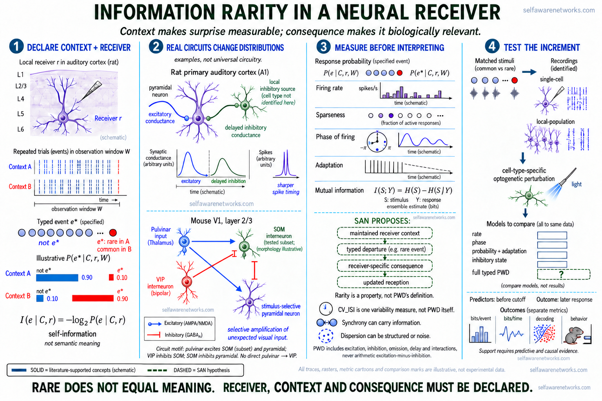

# Information Rarity

## The idea in plain language

A repeated neural state can establish a context. An excitation, inhibition, delay, phase change,
or other event that is unlikely in that context can then carry more **self-information** than a
common event. SAN proposes that this contrast helps explain why an ongoing tonic state can provide
a reference while rarer [[phase-wave-differentials|phase-wave differentials]] carry changing
content.

## What rarity contributes to the SAN mechanism

Rarity is one property that can be measured under a declared expectation; it is not the definition
of PWD. The SAN relation includes excitation, inhibition, a missing expected event, delay, and
interactions relative to the receiver's tonic pattern. A common departure can still have a
consequence. The question here is how its probability and its receiving conditions help explain
that consequence.

The tonic reference need not be an empty background supplied by an analyst. In Micah's
[learning-pixel thought experiment](https://github.com/v5ma/selfawarenetworks/blob/cd95efe985f2b21cca69eb3fd253cf473a268587/b0236y%20ctpr.txt),
elements in a three-dimensional array learn which surrounding patterns precede their own activity.
A written word, visible wheels, and a sound could become related through their history. In the
same source, a red-shirt-related departure changes participating cells as they interact with their
oscillating group. Returning to the earlier frequency does not erase the intervening physical
adjustments. The internal recording dates remain distinct from the June 2022 public text.

The stronger SAN proposal concerns those receiving transformations: a learned and ongoing state
receives a difference, transforms and re-expresses it to other receivers, and can retain changes
that affect the next encounter. Their continuing organization across populations is proposed to
constitute an experienced quality, rather than merely describe a surprising observation. The
Micah-labelled passages in [02san](https://github.com/v5ma/selfawarenetworks/blob/64f018d2d93b7de6718058c4724c43b40e5dd4b7/02san.md)
state this rendering-and-tuning argument. It is a SAN conjecture; calculating surprisal or observing
one component circuit does not establish the complete constitutive claim. See
[[neural-tuning|Neural Tuning]] and [[neural-rendering|Neural Rendering]].



[Open the full-resolution figure](../assets/generated/san/information-rarity/information-rarity-neural-receiver-20261013-v3.png)

*The solid teal pathways summarize established measurements: context-dependent auditory responses,
excitation-inhibition timing, phase-sensitive coding, and a specific pulvinar-VIP-SOM-pyramidal
prediction-error circuit. The dashed green pathway is the SAN hypothesis under test. The question
mark in the held-out comparison is deliberate: the figure defines how a receiver-relative PWD
model could be tested, not a result that it has already outperformed conventional models.*

```text
tonic receiver context -> expected distribution of events
  -> common event: lower conditional surprisal
  -> rare typed deviation: higher conditional surprisal
  -> receiver-specific electrical, plastic, routing, or behavioral consequence
  -> updated expectation and network state
```

This is a conditional claim, not a rule that rarity automatically creates meaning. A rare event can
be noise. A common event can be essential. The probability model, receiver, time window, biological
route, and measurable consequence must all be declared.

## Shannon quantities must remain explicit

For event `e`, receiver `r`, and declared context `C`, conditional self-information is:

```text
I(e | C,r) = -log2 P(e | C,r)                                      [1]
```

An event with lower modeled probability has greater surprisal. This does not establish semantic
meaning, utility, causal influence, or consciousness. Those require additional measurements.

To ask whether a neural response `Y` carries information about a stimulus or state `S`, the more
relevant quantity is mutual information:

```text
I(S;Y) = sum p(s,y) log2 [p(s,y) / (p(s)p(y))]                     [2]
```

Suppressing several candidate neurons on one trial does not retroactively make the surviving event
rarer. Inhibition can alter response distributions, timing, selectivity, correlations, and
sparseness across an ensemble of trials. Whether it increases bits per event, bits per unit time,
or stimulus-response mutual information is an empirical question.

The coefficient of variation can describe one aspect of event timing:

```text
CV_ISI = standard deviation of inter-spike intervals
         / mean inter-spike interval                               [3]
```

`CV_ISI` is not itself Shannon information, phase, meaning, or a complete PWD. SAN's later PWD
proposal treats variability as one candidate dimension within a typed, receiver-relative event
description.

### The same event under a different expectation

In a synthetic two-outcome example, declare a receiver and a deadline `W`. Its model assigns
probability `0.9` to an event arriving by that deadline and `0.1` to its absence. These probabilities
are invented for illustration, not measured neuronal data.

| Outcome by W | Probability under the declared context | Conditional self-information |
|---|---|---|
| Event arrives | 0.9 | about 0.152 bits |
| Expected event does not arrive | 0.1 | about 3.322 bits |

Under a different context in which absence is common, the same absence can have low surprisal.
Thus neither an event's physical label nor the sign of a voltage trace determines its rarity.
The event classes, context, receiver, and observation window determine the probability question.
An omitted input does not transmit a literal missing spike: a study must identify how a prepared
receiver registers the absent contribution and what changes next.

This uses the same conditional self-information in equation [1]. It is not stimulus-response mutual
information, an entire PWD record, or evidence that every omission produces a conscious percept.

## Source recovery: the June 2022 proposal

[[gh-a0590z|a0590z]], first publicly fixed on June 8, 2022, is a mixed neural-and-immune notebook.
Its neural passage asks how the firing of a pyramidal cell could become detectable at network scale
as a representation of that cell's connections. It sketches three rows:

1. one neuron fires;
2. a later neuron fires, inhibits several alternatives, and is associated with dendritic-spine
   change, described as magnifying "information rarity";
3. phase rates across oscillations change, allowing a later system to infer something about the
   pattern active in the preceding layer.

This passage should be preserved as a compact research proposal, not expanded into anatomy it does
not specify. A cortical pyramidal cell is ordinarily excitatory; local suppression of neighboring
principal cells generally requires a named inhibitory-interneuron route. The note also does not
establish that Shannon information causes spines to grow. Structural plasticity, inhibition, and
phase-rate change are candidate linked operations whose relationships require testing.

The recoverable operation is therefore:

```text
selected firing event
  -> anatomically mediated competition or inhibition
  -> altered population timing and response distribution
  -> learned downstream discrimination of the preceding pattern
```

## The dated SAN synthesis

The mature Information Rarity account developed in stages. Later wording must not be backdated
into the first note.

| Public fixation | Source | Contribution |
|---|---|---|
| July 24, 2013 (platform date) | [public Facebook provenance post](https://www.facebook.com/photo/?fbid=692805844079399&set=a.103297033030286) | early ancestor describing cycling synchrony, learned oscillatory patterns, internally rendered vectors, sounds, and worlds, and smaller oscillations joining larger brainwaves to "knit the canvas of conscious experience"; not yet the later information-rarity, Shannon, or PWD mechanism |
| June 8, 2022 | [a0590z](https://github.com/v5ma/selfawarenetworks/blob/5360f6414909a2474129b2140ee0dc3112c93b6b/a0590z.md) | inhibition, spine change, phase-rate change, and the phrase "information rarity" in one proposed sequence |
| June 8-11, 2022 | [a0142z](https://github.com/v5ma/selfawarenetworks/blob/ff8d45af7706a29baaef326fcc4fbcbaa0ed0f06/a0142z.md) | coherence as coupling or convergence, contrasted with decoherence or separation as distinction-making |
| June 21, 2022 | [b0131y](https://github.com/v5ma/selfawarenetworks/blob/b2b7084fb754a3553b3468087aed963a1224ab1b/b0131y.md) | repeated "hmms" as context and a rarer "hey" as a more surprising event under an information-theory reading |
| September 6, 2024 | [02san](https://github.com/v5ma/selfawarenetworks/blob/64f018d2d93b7de6718058c4724c43b40e5dd4b7/02san.md) | Micah-labelled turns describe unexpected excitation or inhibition relative to tonic oscillation as a PWD candidate; generated explanations remain separately attributed |
| June 16, 2025 | [13san](https://github.com/v5ma/selfawarenetworks/blob/0d844d97983ec6e6600063dc54734809516f7f7e/13san.md) | a mixed working document using coefficient-of-variation language relative to collective synchronization; a dated vocabulary stage, not a certified Micah quotation or empirical result |
| 2026 governed synthesis | this page | explicit conditional-probability, receiver, scale, and experimental boundaries |

The joined SAN hypothesis is that a relatively stable tonic pattern supplies the comparison
context, while less common receiver-relative departures can carry differential content and alter
what the system does next. [[coherence-dispersion-sculpting-hypothesis|Coherence and structured dispersion]] can both be functional: compatible timing can support communication, while a departure
from that relation can mark a boundary, error, new feature, or route change.

## What established neuroscience supports

Established results support components of this proposal without proving the joined SAN mechanism:

- Shannon formalized information in relation to probability distributions, not biological meaning.
- Sparse-coding models can learn localized visual features, and recordings from macaque V1 during
  natural vision found increased sparseness and decorrelation under nonclassical receptive-field
  modulation.
- Excitation and inhibition can shape cortical response timing. In rat auditory cortex, balanced
  inhibition rapidly truncated tone-evoked spiking and sharpened its temporal precision rather
  than simply creating a classical lateral-inhibition surround.
- Cat auditory-cortex neurons responded more strongly when the same sound was rare rather than
  common, while the sampled auditory-thalamic neurons did not show the same frequency-deviant
  probability sensitivity in that stimulus-specific-adaptation study.
- In anesthetized macaque V1 during natural-movie viewing, multiunit spike timing relative to
  low-frequency LFP phase carried stimulus information beyond spike count.
- In head-fixed, trained mice navigating a visual corridor, calcium imaging and optogenetic
  manipulations identified a cooperative interaction among pulvinar input, VIP interneurons,
  a specific SOM subset, and stimulus-selective V1 layer 2/3 populations. It amplifies actual
  unexpected visual input rather than establishing a generic difference-vector code; the study
  does not require a serial pulvinar-to-VIP circuit.

These findings show that probability, context, inhibition, phase, and response selectivity can be
biologically consequential. They do not establish one universal novelty circuit, one global tonic
oscillation, or PWD as the neural code.

## The gamma and synchrony boundary

The sentence "perfect synchronization has low information" is defensible only under a declared
code in which that synchronized state is common and changes little. Synchrony can itself carry
information through its onset, duration, participating cells, frequency, spatial organization,
phase relative to another signal, or effect on a receiver. Likewise, desynchronization is not
automatically informative; it may be a structured difference, a route transition, or noise.

SAN's narrower proposition is:

> A common tonic coordination state can act as a low-surprisal reference, while an unexpected,
> typed departure from that state can have higher conditional surprisal and become a candidate PWD
> when a named receiver preserves and uses the difference.

This preserves the intended Claude Shannon bridge without treating gamma power, coherence,
decoherence, entropy, and conscious content as interchangeable measurements.

## Scale and anatomy boundaries

| Scale | Candidate measurement | Boundary |
|---|---|---|
| Cellular | membrane state, dendritic event, spike timing, burst, waveform, release, plasticity | one neuron does not contain or read the whole ensemble code |
| Local circuit | identified excitation, interneuron-mediated inhibition or disinhibition, response distribution, phase relation | pyramidal cells should not be drawn as directly inhibiting generic neighbors |
| Population | sparseness, correlation, oscillatory power, phase organization, decoding, mutual information | an LFP or EEG entropy value is not information per spike or conscious meaning |
| Organism | detection, discrimination, report, learning, and action | rarity or surprise alone does not establish salience, value, or awareness |

The receiver changes across these levels. A cellular deviation, a local-circuit competition, a
population phase relation, and a behavioral surprise can constrain one another without being the
same event.

## A decisive experiment

Use a declared animal sensory pathway in which common and rare stimuli can be matched for physical
features. Record identified cellular activity and a local population signal while manipulating a
specific inhibitory route. For every receiver, estimate its tonic reference from pre-event and
common-event trials.

Compare cross-validated models using:

1. spike count or firing rate alone;
2. timing or phase alone;
3. stimulus probability and adaptation;
4. inhibitory-circuit state and population sparseness;
5. a typed PWD model using the declared reference, source, route, receiving state, and eligible
   departures available before the particular consequence it predicts.

Keep the downstream consequence in the complete event record and measure it as an outcome. It
must not also be supplied as an input to a model predicting that same outcome. Declare the
prediction cutoff; every sample used to estimate a phase, duration, reference, or other feature
must be eligible at that cutoff. Fit the reference and preprocessing on training data before
held-out evaluation. A completed response can enter the history for a still later target, so this
rule preserves feedback and Neural Tuning. The [[phase-wave-differential-calculus|PWD calculus page]]
explains the measurement distinction and its methods sources.

If a fixed analyst feature `D` is computed entirely from observations `X`, conditioning on all of
`X` already determines `D`: `I(D;Y | X) = 0`. A PWD-derived representation can nevertheless expose
information omitted by a reduced baseline, or help a finite learner use the same observations.
Compare models with declared data access and learning budgets, then test the biological receiving
operation through perturbation and rescue. Information beyond a reduced summary, representation
benefit, and causal receiver evidence answer different questions; none replaces the full SAN
mechanism with an analyst's feature.

Report stimulus-response mutual information, bits per event, bits per unit time, held-out decoding,
and behavioral prediction separately. Then perturb the inhibitory route and test whether the
specific information and downstream consequence predicted by the model are lost and rescued.

The stronger SAN account gains support only if the full receiver-relative PWD model predicts and
causally explains later routing, plasticity, perception, or action better than the conventional
alternatives. It is weakened if rarity, phase departure, or PWD dimensions add no reproducible
predictive value after probability, adaptation, firing rate, and circuit state are controlled.

## Image status

The current companion illustration distinguishes normalized, synthetic probability examples,
literature-supported circuit motifs, information measures, and an unanswered SAN model comparison.
Its rasters, traces and comparison marks are schematic rather than experimental data; cell shapes
do not claim the morphological subtype of the measured SOM population.

The [earlier August plate](../assets/generated/san/information-rarity/information-rarity-neural-receiver-20260811-v1.png)
and its bounded internal-review history are preserved. That exact earlier image was included in
the [October 5 public Wiki snapshot](https://github.com/v5ma/selfawarenetworks/commit/9ca5cb840c0913f2b8b72c5de66662a622e79d0f).
Public availability did not close its separately recorded owner and specialist gates. The revised
illustration has its own source, mathematical, biological and visual checks; earlier acceptance
does not automatically certify a generated successor.

## Read next

- [[tonic-context-rare-deviation-tomographic-language|Tonic Context, Rare Deviations, and Tomographic Language]]
- [[phase-wave-differentials|Phase-Wave Differentials]]
- [[phase-wave-differential-calculus|Prediction, Information, and Causal Tests]]
- [[coincidence-as-a-bit|Coincidence as a Bit]]
- [[coherence-dispersion-sculpting-hypothesis|Coherence-Dispersion Sculpting Hypothesis]]
- [[receptor-inhibition-pattern|Receptor and Inhibition Pattern]]
- [[inhibitory-interneurons-plasticity-gating|Inhibitory Interneurons, Plasticity, and Gating]]
- [[dendritic-spines|Dendritic Spines]]
- [[neural-distinction-consciousness|Neural Distinction and Consciousness]]
- [[gh-a0590z|a0590z source note]]
- [[gh-13san|13san: Computable Consciousness, Phase Variability, and Self-Modifying Timing]]
- [Shannon, 1948, part I](https://doi.org/10.1002/j.1538-7305.1948.tb01338.x)
- [Shannon, 1948, part II](https://doi.org/10.1002/j.1538-7305.1948.tb00917.x)
- [Olshausen and Field, 1996](https://doi.org/10.1038/381607a0)
- [Vinje and Gallant, 2000](https://doi.org/10.1126/science.287.5456.1273)
- [Ulanovsky, Las, and Nelken, 2003](https://doi.org/10.1038/nn1032)
- [Wehr and Zador, 2003](https://doi.org/10.1038/nature02116)
- [Montemurro et al., 2008](https://doi.org/10.1016/j.cub.2008.02.023)
- [Furutachi et al., 2024](https://doi.org/10.1038/s41586-024-07851-w)
