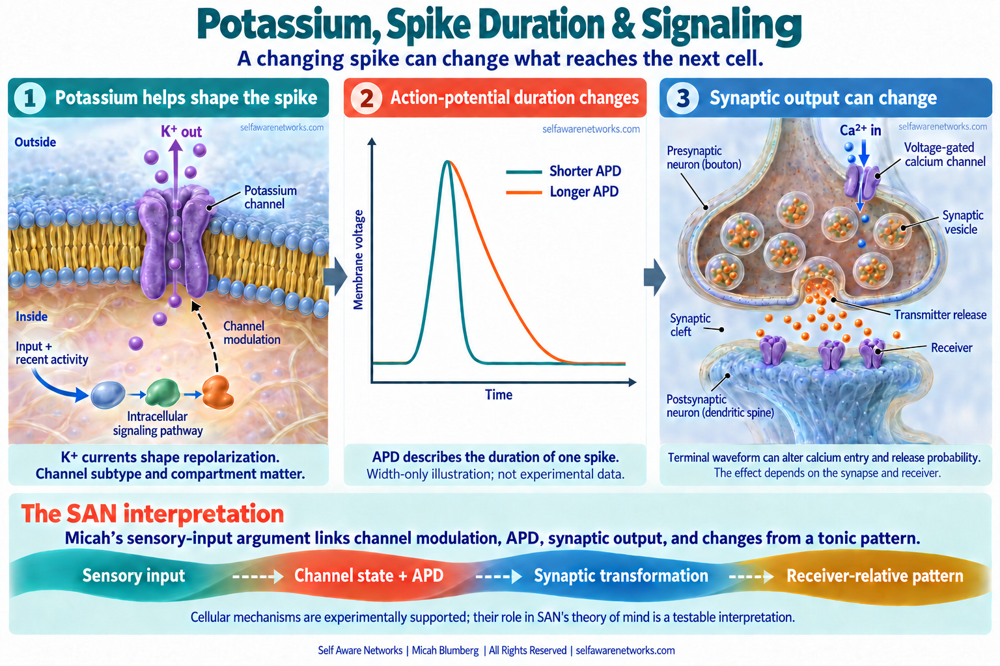

# Potassium Channel Modulation

Potassium-channel modulation is central to SAN's argument that a sensory encounter can change
**the duration and shape of an action potential**, not only whether a cell fires or when its next
spike occurs. The changed waveform can alter what is transmitted onward; another cell receives
that transformed output in the context of its own ongoing activity and learned state.

The joined SAN proposal follows receptor selection, intracellular signaling, local channel state,
electrical waveform, transmission and receiving populations into perception and learning. Its
memory branch asks how changed responsiveness can persist while ions, spikes and individual
molecules do not. Neither branch reduces the theory to one potassium current or one spike-width
measurement.



The membrane and chemical synapse are schematic neuronal examples, not a universal sensory-cell
circuit. The curves compare spike width without claiming recorded data. Terminal waveform can
change calcium entry and release probability; the direction and size of that effect depend on the
channel, compartment, synapse and receiving state. The dashed lower band identifies SAN's joined
sensory-transformation hypothesis.

## The source argument is a transformation chain

In [Taste & Hearing: Sensory Input Quantification](https://github.com/v5ma/selfawarenetworks/blob/75b194fb97d2da09fb8bdd4130be98b910a72adb/a0272z.md),
Micah begins with multiple receptor activations and coincidence detection. Protein morphology and
cellular state determine how an encounter is transformed. He then asks how metabotropic signaling,
including cAMP, could modify potassium and calcium channels, output duration and the effects passed
to other cells. He also explicitly questions the assumption that every terminal of one neuron
must send identical output.

The complete operation is:

```text
input pattern and recent history
  -> receptor and intracellular response
  -> local channel state and membrane current
  -> compartment-specific electrical waveform
  -> modality-specific transmission
  -> receiver-relative change in an ongoing pattern
  -> changed readiness and subsequent reception
```

In SAN, coordinated transformations across neural arrays are proposed to constitute sensory
patterns and experienced qualities. The potassium/APD route is one physical contributor to that
account, not an observer examining a completed picture. Component experiments can support the
route without establishing the full constitutive account of experience.

## Potassium current is not a one-knob timer

For a simple conductance description, using outward-positive current:

```text
I_K(t) = g_K(t) * [V_m(t) - E_K]
```

`I_K` is potassium current, `g_K` is the effective local conductance, `V_m` is membrane voltage,
and `E_K` is potassium's reversal potential. Channel availability and gating, the driving force,
other currents and cellular geometry all matter. Potassium current is not a count of released
neurotransmitter vesicles.

Outward potassium current can contribute to repolarization. Changing it can affect spike width,
afterpotentials, excitability or firing pattern, depending on the channel and preparation. Spike
duration and the interval until a later spike are different measurements. Changing APD does not
guarantee a particular next-spike time or a fixed population phase reset.

[[action-potential-duration|Action Potential Duration]] distinguishes a spike's width from burst
duration, postsynaptic-event duration and the duration of a population pattern.

The familiar potassium-current framework predates SAN; the classic quantitative nerve-current
account is [Hodgkin and Huxley, 1952](https://doi.org/10.1113/jphysiol.1952.sp004764).
The expression above is a conductance description, not a complete channel-kinetics model or new
experimental data.

## Experimental anchors for different parts

- **Intracellular modulation:** in the identified Aplysia neuron R15, serotonin-induced increases
  in potassium conductance were mediated by cAMP. Later work in the same identified-cell system
  described cAMP-dependent modulation of potassium, calcium and chloride currents. One messenger
  can therefore affect several currents; it is not a universal potassium-only pathway.
  [Levitan and Adams, 1981](https://pubmed.ncbi.nlm.nih.gov/6269405/),
  [Lotshaw and colleagues, 1986](https://doi.org/10.1242/jeb.124.1.307).
- **Axonal waveform:** in mouse cortical slices, Kv1 currents helped determine repolarization in
  layer-5 pyramidal-cell axon collaterals and presynaptic boutons. Somatic depolarization broadened
  spikes in bouton-bearing collaterals, and the effect depended on Kv1 channels.
  [Foust and colleagues, 2011](https://doi.org/10.1523/JNEUROSCI.2752-11.2011).
- **Terminal specificity:** recordings from cerebellar stellate-cell axons found differing spike
  widths across boutons, including sites on the same branch. Local Kv3-channel clustering and
  expression contributed to that variation. This is a specific example relevant to Micah's
  terminal-output question, not evidence that all terminals use identical or equally variable
  waveforms. In the same mouse cerebellar preparation, local potassium-channel blockade broadened
  bouton spikes and increased the amplitude and time to peak of GABA autoreceptor currents;
  paired-pulse measures also changed at the targeted axon site. Those are release-related
  response and timing measurements, not direct counts of vesicles or perceptual content.
  [Rowan and colleagues, 2016, Figure 7](https://doi.org/10.1016/j.neuron.2016.05.035).
- **Firing-pattern regulation:** Brown and Adams identified muscarinic suppression of a distinct
  M-current in frog sympathetic neurons; Wang and colleagues later identified KCNQ2/KCNQ3
  contributions to native M-current. This is an excitability/input-response route, distinct from
  the Kv1/Kv3 waveform examples. [Brown and Adams, 1980](https://doi.org/10.1038/283673a0),
  [Wang and colleagues, 1998](https://doi.org/10.1126/science.282.5395.1890).

The M-current branch asks whether changed subthreshold responsiveness can change tonic/phasic
firing patterns and what reaches the next receiver, even at matched mean firing rate. The
Brown/Wang results identify a current and its input-response role; they do not establish a
universal tonic-to-phasic conversion. A firing mode, one spike's APD and a receiver-relative
population phase remain different measurements.

The expanded `a0272z` also follows dual control of a pacemaker current in identified
Helix aspersa and Helix pomatia fast-burster neurons: calcium activates a nonselective cation
current, while cAMP-dependent phosphorylation down-regulates it. Serotonin-related modulation
changed bursting to beating activity. Micah connects this pacemaker example to tonic rhythmic
state. That preserves both arms of the source's rhythmic-state branch without relabelling a
nonselective current as a potassium current, or equating bursting/beating with APD or a
population phase measurement.
[Partridge and colleagues, 1990](https://doi.org/10.1113/jphysiol.1990.sp018248).

Those experiments measure distinct currents and compartments. None alone shows that a particular
sensory category selects a universal APD symbol or that potassium modulation establishes a
conscious quality.

## Sensory implementations must keep their anatomy

The common SAN operation is receive, transform and project; the biological implementation differs.

In acutely isolated type-II taste cells, temperature affected action-potential properties and voltage-gated
sodium and potassium conductances. This supports waveform sensitivity in a defined sensory-cell
preparation, not a potassium-only intervention or a proof that recognition determines spike width.
[Ma, Paudel and Foskett, 2023](https://doi.org/10.1152/ajpcell.00413.2022).

Type-II taste cells pass ATP through voltage-gated CALHM1/3 channels to gustatory nerves.
That channel-mediated output is not the conventional calcium-triggered vesicle-release diagram
above. CALHM3 deletion abolished taste-evoked ATP release and GPCR-mediated taste responses in
the tested mice. [Ma and colleagues, 2018](https://doi.org/10.1016/j.neuron.2018.03.043).

The auditory gating-spring discussion in `a0272z` is a further component bridge, not proof that
every hair cell runs a potassium-to-spiking-neuron cascade. The [[auditory-gating-spring-camp]] and
[[receptor-to-phase-sensory-quantification]] articles distinguish sensory-cell transduction from
the later spiking and synaptic stages. The receiving compartment and actual output mechanism
must be specified before measuring the proposed APD contribution.

## Memory: retain the question, separate the compartments

The later [rexnote03 dialogue](https://github.com/v5ma/selfawarenetworks/blob/3baf28fb4f739b7f2434fc8b7f7db0f0f33635e1/rexnote03.md)
contains a human-labelled prompt joining sensory receptors, potassium-related cellular changes,
calcium, APD and transmission. The next human-labelled question asks how those mechanisms relate
to KIBRA anchoring PKMzeta. This preserves a serious systems question: **how does a transient
electrical encounter change what a network can do later, and what maintains that changed
responsiveness?**

The account connects two different operations rather than assigning them to one compartment:

1. A presynaptic waveform and terminal state can change the transmission encountered by another
   cell.
2. Postsynaptic receptors, plasticity and molecular maintenance can help retain an altered
   responsiveness when the pathway is re-engaged.

In rats, PKMzeta inhibition affected memory and postsynaptic GluR2-containing AMPA receptors;
blocking their removal prevented the studied impairment and reversal of potentiation.
[Migues and colleagues, 2010](https://doi.org/10.1038/nn.2531).

The 2024 KIBRA work studied established hippocampal late-LTP in acute slices and long-term spatial
memory in male mice. Disrupting KIBRA-PKMzeta dimerization disrupted those established outcomes
without a measurable effect on basal transmission. Its knockout controls also distinguished
compensating PKCs. The result supports a particular molecular-maintenance mechanism, not a
human intervention result or a universal explanation of every memory.
[Tsokas and colleagues, 2024](https://doi.org/10.1126/sciadv.adl0030).

SAN's extension asks whether maintained synaptic readiness helps preserve and later re-express
receiver-relative population patterns. Returning ionic activity toward its prior condition need
not erase changes in receptors or connections. The KIBRA study did not measure a stored PWD,
establish that KIBRA directly controls presynaptic vesicle counts, or show that potassium-channel
blockade destroys the anchoring interaction.

The dialogue's assistant answer supplies the stronger vesicle-potassium-calcium-cycle wording,
which was carried into [rexnote12](https://github.com/v5ma/selfawarenetworks/blob/4e8e279ad27a1c29c4876e3db287d35664e27b91/rexnote12.md).
That wording is part of the historical synthesis, not independent experimental evidence or a
certified quotation from the human prompt. Preserving the original question does not require
equating presynaptic release with postsynaptic molecular anchoring.

## Source development

These are dated Git-text stages, not automatically the dates of composition or first public access.

| Dated source stage | Preserved contribution |
| --- | --- |
| [June 8, 2022, early a0053z transcript](https://github.com/v5ma/selfawarenetworks/blob/7d1431213cd4ac9788848a5396ec2992ece11cfd/a0053z%20ctpr.txt) | A precursor joining transmitter quantity, potassium/sodium channels, altered firing and propagation across oscillating groups; not yet the later complete APD chain. |
| [August 3, 2022, a0053z version](https://github.com/v5ma/selfawarenetworks/blob/b79351a4fe3667296952c483e6beb68732bf3865/a0053z.md) | The Action Potential Magnitude Effect question joins phasic activity, calcium-channel duration, transmitter distribution and later array activity. Its inhibition and dissipation examples require specified biological routes, not a universal excess-transmitter inhibition law. |
| [August 10, 2022, a0272z](https://github.com/v5ma/selfawarenetworks/blob/75b194fb97d2da09fb8bdd4130be98b910a72adb/a0272z.md) | Receptor diversity, intracellular modulation, potassium/calcium-related output duration and potentially different terminal outputs. |
| [September 17, 2022, expanded a0272z](https://github.com/v5ma/selfawarenetworks/blob/7129fcf82a9d42665a1372ecdc803e912bc81b6a/a0272z.md) | Adds the Helix calcium-activated nonselective-current and bursting-to-beating discussion; this is a distinct rhythm-modulation component, not a measured APD result in all sensory cells. |
| October 24 and 27, 2024, rexnote03 and rexnote12 | Human-labelled sensory and molecular-memory questions, assistant-generated bridge explanations and their compiled reuse remain distinguishable. |

Channel physiology predates these SAN notes. SAN's documented contribution here is the joined
sensory-to-receiver and recurrent-memory interpretation, not discovery of potassium currents,
cAMP signaling or KIBRA-PKMzeta itself.

## What would test the joined mechanism?

Record a defined sensory encounter, channel state, somatic and terminal waveforms, transmission,
receiver response and later discrimination. Compare APD alone with the full waveform and with
rate, timing, baseline voltage, adaptation, movement and arousal controls.

Use a compartment-specific channel intervention and rescue to test the waveform-to-transmission
arrow. For the memory branch, manipulate molecular maintenance separately, after measuring its
effects on postsynaptic responsiveness. Then test whether later re-engagement changes the
predicted pathway, population pattern and behavioral recall together. A broad channel blocker is
not by itself an intervention on KIBRA anchoring.

For the M-current/firing-mode branch, compare channel interventions at matched mean firing rate
and ask whether downstream patterns or discrimination differ. Measure spike timing, firing mode,
waveform and other drug effects separately; equal average rate alone does not isolate the
waveform mechanism. A downstream difference must survive those controls before it can support
the proposed channel-to-receiver explanation.

Keep each completed consequence as an outcome of that encounter; it can become eligible history
for a later encounter. References and waveform features used to predict an outcome must be
estimated from information available before that outcome, with training-only fitting for held-out
tests. This preserves feedback while avoiding prediction from the answer itself.

APD is one possible coordinate of a [[phase-wave-differentials|PWD]], not its definition.
Excitation, inhibition and other typed changes remain relative to a declared tonic pattern and
receiver. A change in spike width matters to the SAN account through its transformed consequence
and subsequent use, not because a width measurement alone names an experience.

## Read next

- [[action-potential-duration|Action Potential Duration]]
- [[action-potential-waveform|Action Potential Waveform]]
- [[umami-multi-receptor-coincidence-detection|Umami Reception and ATP Output]]
- [[receptor-to-phase-sensory-quantification|Receptor-to-Phase Sensory Quantification]]
- [[camp-neural-phase-modulation|cAMP and Channel Modulation]]
- [[kibra-pkm-zeta-memory-anchor|KIBRA-PKMzeta and Memory Persistence]]
- [[memory-persistence|Memory Persistence]]
- [[neural-tuning|Neural Tuning]]
- [[phase-wave-differentials|Phase-Wave Differentials]]
- [[san-book2-bridge-atlas|Book 2 and the Bridge Atlas]]
