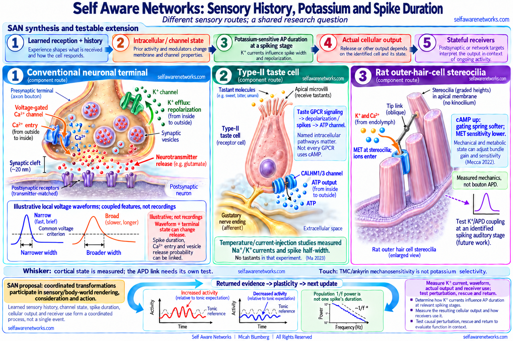

# Stimulus History and Action-Potential Waveform

SAN's sensory argument connects **learned receiving structure**, present input
and recent history to intracellular and ionic changes, **potassium-sensitive
action-potential duration**, actual output, stateful receivers and a recurring
sensory/body-world rendering. The duration step is central to the proposed
spiking-cell operation, not a disposable alternative to spike count. The
particular sensory cell and downstream route must nevertheless be identified:
not every receptor cell communicates through the same neuronal bouton.

Regenerative, all-or-none spike initiation does not require every waveform or
consequence to be identical. A local spike's peak, width, repolarization,
afterpotential and timing depend on conductances, compartment and history.
The source proposal asks how those differences are transformed and used, not
whether a completed percept is already contained in one spike.



> **Figure scope:** The three component routes are distinct: a conventional
> neuronal vesicle synapse, type-II taste-cell CALHM ATP output, and rat
> outer-hair-cell mechanotransduction. The hair-bundle inset is schematic,
> not a measured molecular structure. Neuronal widths use one common voltage
> criterion; Ma's separate taste-cell experiment measured half-width.
> Traces, relative activity and the population spectrum are illustrative,
> not recordings. The full reception/rendering/action/return band is SAN's
> synthesis and extension, not a result already demonstrated by one of these
> component experiments or a universal broader-means-stronger law.

## The complete sensory operation

The source family links:

```text
experience changes receptors, morphology, connections and prior state
-> current sensory pattern is selectively received
-> intracellular and membrane/channel conditions change
-> potassium-sensitive duration and other local waveform features change
   at an identified spiking stage, or another declared cellular output changes
-> actual transmission reaches stateful receivers
-> distributed sensory/body-world rendering, consideration and action
-> returned sensory/body evidence changes the next update
```

The [[gh-a0272z|taste/hearing source]] explicitly proposes a connection from
receptor activation and intracellular signaling through potassium/channel
conditions to output duration, calcium/release and differentiated downstream
patterns. Its whole purpose is not merely to classify a stimulus with an
external decoder. Other notes connect the transformed spatial-temporal pattern
to how flavor, sound and touch are experienced through coordinated receiving
arrays. That constitutive rendering proposal remains SAN theory, distinct
from experiments demonstrating individual ionic or circuit components.

## What stimulus-history experiments establish

In rat visual-cortex pyramidal neurons driven with naturalistic conductance
patterns, somatic spike waveforms reliably carried information about preceding
input for up to about 50 ms. In that preparation they carried information not
captured by instantaneous firing rate alone
([de Polavieja et al., 2005](https://doi.org/10.1523/JNEUROSCI.0242-05.2005)).
The study also links waveform-dependent shunting to subsequent spike production;
its model examines how slow conductances can preserve stimulus history.

Keep the actual endpoints distinct: a somatic local history code, its effect
on later integration and a modeled memory mechanism are not direct recordings
of every bouton, a learned object identity or conscious experience. A waveform
can matter locally to subsequent integration or back-propagating activity;
its only possible function is not to cross one chemical synapse unchanged.

For a conventional presynaptic terminal, waveform-dependent calcium entry,
fusion and receptor responses are further transformations. See
[[action-potential-waveform]] and [[action-potential-duration]] for their
preparation-specific sources and metric distinctions.

## Potassium flux and APD are linked but not interchangeable

The source's potassium language concerns a cell's changing electrical state
and output. Potassium ions are positively charged. Outward potassium current
can help repolarize the membrane by removing positive charge from its interior;
it is not a flow of negatively charged potassium or a literal packet of
potassium transported through neurotransmitter vesicles into the next cell.

Declare the channel, current direction, recording location and duration metric.
A half-width is not automatically the full event duration, burst duration,
postsynaptic-current duration or a population timescale. Peak, duration, slopes
and afterpotentials are coupled, so potassium quantity alone is not a universal
controller fixing every waveform or output. A channel intervention can change
more than width.

The positive SAN operation remains: learned and present receiving conditions
change ionic/channel state; local duration and actual output can change; a
receiver transforms the consequence against its own state. Calcium or release
can mediate that contribution rather than compete with it as a reason to
discard the waveform. See [[potassium-channel-modulation]].

## Distinct sensory laboratories

### Whisker input and cortical state

The whisker note connects active sensing, thalamocortical input, dendritic
coincidence, tonic/phasic organization and the rendered tactile world. Its
proposal is that distinctions in the ongoing pattern are registered by learned
receiving arrays, not that every whisker contact must broaden every spike.

In behaving mice, paired layer-2/3 barrel-cortex recordings showed correlated
membrane potentials during quiet wakefulness and reduced correlation during
whisking, with desynchronized local field/EEG activity and sparse spiking.
Spike initiation had higher signal-to-noise ratio during active whisking in
that preparation ([Poulet and Petersen, 2008](https://pubmed.ncbi.nlm.nih.gov/18633351/)).
This is a state/synchrony/input result, not a direct APD recognition experiment.
The earlier [Crochet and Petersen study](https://doi.org/10.1038/nn1690) is a
separate whisker/membrane-state source, not the same paper or measurement.

Do not identify generic excitability, gain and signal-to-noise ratio as one
quantity with a universal direction. Test the source family's potassium/APD
link at a named spiking sensory or cortical stage while measuring state,
input, local waveform and receiver use. The particular whisker body supplies
the state/coincidence/rendering argument; not every wider family's ionic step
is explicitly present in that one note.

### Mechanically selective molecular structure

The mechanosensory source uses receptor configuration and tethering to explain
how structure selects input and changes cellular response. The cited
[ankyrin/TMC study](https://pubmed.ncbi.nlm.nih.gov/32325031/) identifies
UNC-44/ankyrin and CIB proteins in a TMC-1 mechanotransduction complex in
*C. elegans*, including the studied sensory-cilium and muscle conditions.
It does not establish that every touch transducer is potassium-selective or
that the worm experiment measured mammalian whisker APD.

Preserve the intended force-sensitive structure -> cellular signaling/voltage
-> downstream channel/duration/output operation. Name the actual transduction
channel separately from the proposed potassium/APD coupling at the subsequent
spiking stage; measure that link rather than relabeling TMC as a potassium pore.

### Umami and type-II taste-cell output

The original note emphasizes multiple receptors, combinations, intracellular
integration and a proposed potassium/duration link. Population receptor
diversity is not automatically proof that every receptor is co-expressed or
coincidently activated in one cell. Nor does every GPCR use cAMP as its primary
transduction pathway; named pathway and modulatory hypotheses remain distinct.

Type-II taste-bud cells sensing GPCR-mediated tastes use voltage-activated
CALHM1/3 ATP-release channels to communicate with gustatory nerves, rather
than the conventional neuronal calcium-triggered vesicle route illustrated
above ([CALHM3 study](https://pubmed.ncbi.nlm.nih.gov/29681531/)). Separate
intracellular calcium signaling from an asserted presynaptic calcium/vesicle
release mechanism.

The potassium/APD component has direct peripheral physiology to investigate:
[Ma et al., 2023](https://pubmed.ncbi.nlm.nih.gov/37273235/) recorded action
potentials and voltage-gated sodium/potassium conductances in isolated mouse
type-II taste cells while varying temperature. The reported duration is
half-width under two different current-injection protocols, not tastant
recognition, a width-only intervention or direct measurement of experienced
umami. The study explicitly did not use tastants. Joining this excitability
result to the CALHM-output literature is a bridge between component studies,
not a single already completed experiment of SAN's whole route.

Slower receptor-potential oscillations and the faster spikes riding on them
are also different events
([Nakao et al., 2022](https://pubmed.ncbi.nlm.nih.gov/35694396/)). Preserve
the source's frequency/magnitude and rendering proposal without confusing an
oscillation's duration with one action potential's half-width. See
[[umami-multi-receptor-coincidence-detection]].

### Hearing, mechanics and intracellular modulation

The hearing example connects a mechanically gated input with biochemical
modulation and proposes subsequent changes in neuronal output. In the cited
[rat outer-hair-cell study](https://pubmed.ncbi.nlm.nih.gov/35858439/), Mecca,
Caprara and Peng found that raising cAMP reduced mechanotransduction sensitivity
consistently with reduced gating-spring stiffness; prolonged depolarization
had a related effect. This is direct mechanical/sensitivity evidence, not a
measurement of a conventional neuronal bouton's APD or vesicle code.

Do not reverse the measured cAMP-to-spring relation into proof that every sound
first raises cAMP and then changes potassium/APD. Distinguish the hair-cell
transduction stage from later spiking auditory-network stages. The proposed
potassium/duration/output coupling can be tested at an identified spiking
stage without pretending the mechanotransduction experiment already recorded it.

### Recognition, novelty and surprise

These are relations between input, learned history and present organismal
state, not synonyms for spike broadening. The source proposal includes
changed duration, kinetics, bursting, inhibition, recruitment and receiver
patterns relative to a tonic expectation. Compare expected, recognized and
novel conditions without making one universal width direction the theory.

## The received difference and experienced pattern

At a conventional neuronal chemical synapse, local waveform can change calcium,
fusion probability and transmitter time course, which the receiver's receptors
and membrane/biochemical state transform again. Type-II taste ATP output and
the measured hair-cell mechanism are different routes. A somatic width alone
does not determine all those outputs or uniquely reconstruct their source.

The source's "observing" dendrites and arrays refer to physical reception and
transformation of patterns, not a person hidden inside a neuron. In the
stronger constitutive account, learned, coordinated transformations participate
in the experienced tactile, flavor, sound and body/world rendering itself.
Consideration, action and returned evidence continue that operation.

The source's glial example is a stateful contribution, not just a cell-type
label. A directly relevant mouse study measured rapid, focal depolarizations
in peripheral astrocyte processes. Presynaptic potassium efflux and
electrogenic glutamate transport contributed to those depolarizations, which
slowed glutamate clearance and enhanced neuronal activation by glutamate
([Armbruster et al., 2022](https://doi.org/10.1038/s41593-022-01049-x)).
This supplies a concrete neural-glial component: neuronal activity changes
local ionic/glial state; clearance changes; subsequent neuronal reception
changes. It does not by itself establish SAN's full rendering identity.

Read the source's shorthand through that quoted transporter mechanism:
inhibition of glutamate **transporters** is not a universal inhibitory
identity of glutamate or necessarily vesicular glutamate secretion. Preserve
the positive neural-glial contribution without turning every glial voltage
or calcium response into a conventional fast neuronal spike.

Its wider cellular-learning extension treats receptor/protein configuration as
a remembered responsiveness: coincident inputs gate intracellular and gene-
regulatory functions, and changed structure/state affects future reception.
These are substantive cellular memory/computation proposals. Their specific
mechanisms and tests remain distinct from a claim that one sensory experiment
has already demonstrated every cell's learning architecture. See
[[cellular-oscillating-tomography]] for that broader source context.

## A population spectrum is not a single spike

For a fitted aperiodic spectral component over positive frequencies, a model
may be written `S(f) = C f^(-beta)`, with declared range, normalization and
parameters. Power spectral density and an amplitude spectrum are different
quantities; neither is the peak or duration of an isolated action potential.
Oscillatory peaks and the aperiodic component also require separate treatment.

The Micah/James Bonaiuto dialogue poses a cross-scale question about cellular
frequency/duration and population frequency/magnitude. Preserve that question;
it is not proof of a universal inverse law or of "spike magnitude = peak times
duration" as a physical energy measure. A bridge needs a forward model,
declared cellular/current distributions and field-measurement geometry, with
simultaneous observations at the relevant scales.

### Phase fields, receiving arrays and learned geometry

In the July 2022 proposals, tonic electric and magnetic phase patterns serve
as expectation attractors that change coupling, decoupling, tuning,
synchronization and phase relations. Successive learned receiving arrays
detect ordered coincidences in space and time, transform them into sensory
contours, and project a new pattern to the next array. Coincidence-dependent
changes in neuronal and glial connections alter subsequent reception. The
positive proposal is thus a continuing physical rendering and learning
operation, not merely a field label or an external classifier.

These are attributed SAN field/receiver contributions alongside the identified
channel/APD/output stages. Their particular coupling strengths, geometry and
timescales require tests; the ionic and sensory component studies above do
not establish the entire field/receiver mechanism. Taylor/tensor and tomography
formulations describe a proposed mathematical/physical organization, not
demonstrated symbolic calculus inside each cell or an isolated conscious EM
field without receiving arrays. Signed departures include both excitation
and inhibition relative to the tonic pattern. See [[napot-overview]] and
[[phase-wave-differential]].

### The later coupled duration update

The later, mixed/compiled `13san` source proposes a coupled update, not only
a variability label. Recent timing and current duration, synaptic structural
gains/losses, and a network reference phase influence the next duration. Those
synaptic and reference-phase variables also evolve with coincidence history
and network activity; plasticity and recurrent phase resetting therefore
change the effective update from one cycle to the next.

This is a proposed multi-timescale mechanism, not an experimentally established
universal APD controller. CV is one suggested summary, not the whole ordered,
signed phase/receiver pattern or a sufficient consciousness test. The June
2025 compiled snapshot contains multiple voices; do not attribute every
assertion to Micah, backdate the update into the 2022 sources, or treat a
computability/simulation claim as a completed biological demonstration.

## An archived objection is not blanket physiological authority

The internally dated February 2014 `a0263z` passage is unsigned adversarial
context. Its quoted statements addressed to "you" do not independently identify
their speaker. Square is separately quoted about compartment-dependent
back-propagation. A self-report of medical coursework is not a primary experiment.

Membrane potential is a voltage difference across a membrane. Regenerative
initiation and peak amplitude are different concepts; dendritic back-propagation
does not require an excess above a supposed universal axonal voltage maximum.
But identical spikes in a simplified course model do not prove invariant
biological waveforms. Do not endorse the whole passage's rhetoric or its
cell-membrane/cytoplasm wording as anatomy, or turn it into a wholesale verdict
on SAN. Preserve the valid distinctions using the specific physiology and
the original pattern-to-output question in context.
For a direct compartmental back-propagation example, see
[Stuart and Sakmann (1994)](https://doi.org/10.1038/367069a0).

## Discriminating studies

Choose the sensory cell, spiking stage, receiver and learned relation. Measure
input, intracellular/channel state, potassium current where relevant, local
APD/full waveform, the **actual** ATP/vesicle/other output route and a receiver
or population/behavioral consequence. Declare feasible exposures; potassium
and temperature manipulations can change more than width. Test selective
perturbation, matched alternatives, rescue and return-dependent updating.

Membrane state, calcium, release and receiver responses may be mediators of
the proposed operation. Separate total effects, mediation and incremental
prediction rather than demanding that a contribution remain after every
mediator is conditioned away. A matching rate-only implementation or null
selective intervention can limit a specified waveform contribution under the
declared conditions; a failed estimator is not a universal rejection rule.
Likewise, a successful component result is not proof of experience's identity.

For the field/geometry branch, specify physical field and phase variables,
coupling, timescale, receiving arrays, learned geometry and competing causes;
generic APD measurement alone is not the whole branch test. For the later
coupled-update branch, compare histories matched in scalar CV but different
in temporal order or phase, declare which distinctions the implementation
needs, and perturb/rescue the named local or reference-phase pathway.
Measure eligible later APD, actual output and receiver/update consequences.
These are constructed discriminating designs, not completed experiments.

Specify the target time and observation cutoff. Completed APD may only be
available after the earliest calcium or release event has begun. Use an
available waveform prefix for an early target and completed consequences as
history for a later update, never the outcome to predict itself. Match fitting
resources and preserve held-out pre-outcome references.

## Source genealogy

- [a0263z](https://github.com/v5ma/selfawarenetworks/blob/5af8b6aa029594d221ad72c9e0a5ce2ed2ab3a98/a0263z.md): internally dated February 14, 2014 objection; Git-fixed June 11, 2022. Attribution and original public custody remain separate.
- [a0149z](https://github.com/v5ma/selfawarenetworks/blob/c1682490016bdd2f9ee1bcb0d30aba1aab1460dd/a0149z.md): July 9, 2022 snapshot of phase sequences, field-attractor/receiving-array operations, rendering and the cellular-to-population scale question.
- [a0115z](https://github.com/v5ma/selfawarenetworks/blob/b382dc3d879346a56f74bcd4e772b3b8dfb76a89/a0115z.md): July 17, 2022 snapshot with the named 1/f dialogue, sensory reconstruction and oscillatory representation proposals.
- [a0053z](https://github.com/v5ma/selfawarenetworks/blob/b79351a4fe3667296952c483e6beb68732bf3865/a0053z.md) and [August-9 a0008z](https://github.com/v5ma/selfawarenetworks/blob/81eacc22f252374931b02096a2fafef486ce86e8/a0008z.md): distinct burst/spread and learned-structure/K-duration/output source contributions, not every step in every body.
- [a0272z](https://github.com/v5ma/selfawarenetworks/blob/75b194fb97d2da09fb8bdd4130be98b910a72adb/a0272z.md): August 2022 taste/hearing and intracellular-channel-duration hypothesis, including proposed individual terminal modulation.
- [a0296zWhisker](https://github.com/v5ma/selfawarenetworks/blob/4e0cf1ee0975c01dc57182368497d3f0cd864030/a0296zWhisker.md): November 28, 2022 snapshot of state, coincident input, tonic/phasic distinctions and rendered tactile qualia.
- [a0011z](https://github.com/v5ma/selfawarenetworks/blob/bf6e02b538ad8c24460fbf63bbd380a4f9ef5eb3/a0011z.md): January 4, 2024 fixation of a compiled cellular-learning/mechanosensing discussion with earlier dated material; not a claim that every paragraph was first composed that day.
- [13san](https://github.com/v5ma/selfawarenetworks/blob/172e778a01b06357e5921d772f8ff18f9818a7d3/13san.md): June 16, 2025 mixed-voice snapshot proposes the coupled duration/plasticity/reference-phase update explained above. Its CV, computability and simulation claims have separate evidence scopes; not every statement has identified Micah authorship.

These date types establish contextual genealogy, not independent confirmation
or permission to backdate every later mechanism. The [[san-book2-bridge-atlas|Book and Bridge Atlas]]
can explain later connections as read-only donors; inclusion alone does not
certify an original source, a speaker or the whole scientific account.

## Related concepts

- [[action-potential-duration]]
- [[action-potential-waveform]]
- [[action-potential-waveform-encoding]]
- [[action-potential-magnitude-via-duration]]
- [[phase-wave-differential]]
- [[cellular-oscillating-tomography]]
- [[neural-array-projection-oscillation-tomography]]
- [[early-a0255-a0276-obscure-argument-map|Early a0255-a0276 Obscure Argument Map]]
- [[potassium-channel-modulation]]
- [[umami-multi-receptor-coincidence-detection]]
- [[napot-overview]]
- [[san-book2-bridge-atlas]]

