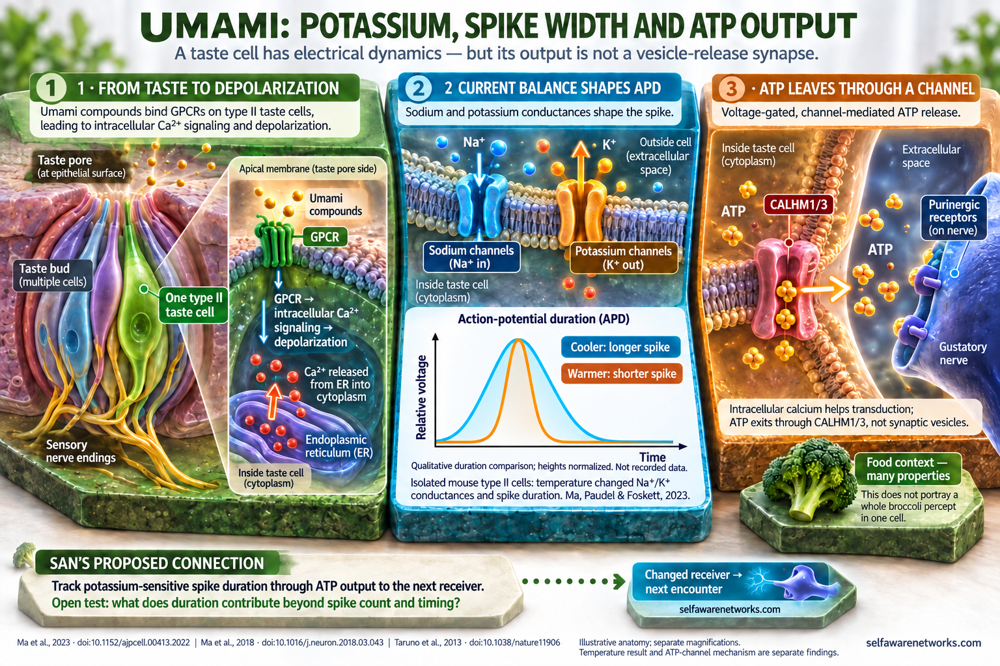

# Umami Receptor Diversity and Coincident Sensory Inputs

The three panels follow reception, electrical transformation and output. The anatomical insets use separate magnifications; the normalized spike curves illustrate duration rather than reproduce recordings. Colored ions, transmitter symbols and channel shapes are explanatory graphics, not molecular structures or calibrated concentrations. The lower band identifies SAN's proposed contribution from duration to the next receiver, not a completed end-to-end experiment. This figure carries the corrected Book 2 explanation into the Wiki.

Umami detection is not exhausted by one receptor type. Work cited in `a0272z.md` describes evidence
that multiple receptor families and different taste-cell subsets can contribute to umami responses.
That supports a combinatorial peripheral input problem: different mixtures can change the pattern of
receptor and taste-cell activation. It does not establish that one receptor population contains the
complete taste experience.

Sources include [Chaudhari, Pereira, and Roper's 2009 review](https://doi.org/10.3945/ajcn.2009.27462H)
on multiple proposed umami receptors and [Taruno et al.'s 2013 experiment](https://doi.org/10.1038/nature11906)
on CALHM1-dependent ATP release in tested mouse sweet, bitter, and umami taste cells.

## SAN significance

Micah uses umami as a component example of [[cellular-oscillating-tomography|COT]] and
[[napot-overview|NAPOT]], not merely as a resemblance to cortical processing. In his source,
protein morphology and cellular state determine which chemical patterns recruit particular
receptors, the intracellular reactions they cause, and the outputs that reach other receiving
cells. He proposes that changing oscillatory relationships coordinate the distributed responses
into sensory patterns, including the experienced taste.

That is the positive joined argument. Receptor biology supplies components to investigate it;
one taste-cell response does not contain a complete food percept. Nor is a single rising and
decaying response, by itself, proof of oscillation or of COT's proposed binding operation.
[[coincidence-pattern-neural-information|Coincidence]] here concerns the pattern and conditions
of reception, not a claim that every umami event requires a fixed logical AND of all receptors.

The source-faithful SAN question is whether receptor diversity, cellular state, potassium-sensitive
action-potential duration, downstream transmission and later network context provide a richer
account of sensory discrimination than a one-receptor or one-scalar description. The original
[[gh-a0272z|Taste and Hearing note]] explicitly asks how intracellular signaling can change potassium
and calcium channels, output duration and the effects passed to later receivers. Reducing that
argument to receptor diversity or spike timing alone loses a central proposed transformation.

## Potassium, APD and ATP output

1. **Receive and depolarize.** In the illustrated type-II taste-cell route, umami-related GPCR signaling recruits intracellular calcium release and depolarization. The intracellular calcium store and the eventual output channel have different roles.
2. **Shape the action potential.** Sodium and potassium conductances contribute to the waveform. [Ma, Paudel and Foskett (2023)](https://pubmed.ncbi.nlm.nih.gov/37273235/) recorded temperature-dependent changes in spike properties and voltage-gated conductances in isolated mouse type-II taste cells. Warmer conditions produced shorter spikes in the tested range. The figure's equal-height curves are an explanatory width comparison; warming was not a potassium-only intervention.
3. **Pass ATP to the next receiver.** The output of this cell type uses voltage-gated CALHM1/3 channels. [Ma et al. (2018)](https://pubmed.ncbi.nlm.nih.gov/29681531/) identified the fast channel mechanism and tested its contribution to GPCR-mediated taste signaling in mice. ATP reaches purinergic receptors on a separate gustatory nerve ending.
4. **Test the joined SAN relation.** Measure how a change in potassium-related state and APD affects ATP output, afferent activity and subsequent discrimination, alongside spike count and timing. The APD experiment and the CALHM experiments supply different parts of that chain; the complete duration-to-perception relation requires its own test.

The question therefore survives the cell-specific anatomy: what information does a changed duration
make available to the next receiver, under which conditions? A conventional neuron's calcium-dependent
vesicle release and a type-II taste cell's ATP-channel output are distinct implementations to examine.
See [[action-potential-duration]] and [[potassium-channel-modulation]].

## Several receptors, different evidence

The receptor-diversity argument has more than one experimental basis:

- A receptor cloned from rat taste buds and expressed in CHO cells responded to glutamate and
  coupled negatively to a cAMP cascade. This is a specific taste-mGluR4 candidate route, not a
  demonstration that every umami-sensitive cell uses the same cAMP-to-potassium mechanism.
  [Chaudhari, Landin and Roper, 2000](https://doi.org/10.1038/72053).
- T1R1 and T1R3 combine into a heteromeric amino-acid receptor. The tested human/mouse sequence
  differences affected response selectivity. Two receptor subunits in that complex are not two
  independently counted umami systems. [Nelson and colleagues, 2002](https://doi.org/10.1038/nature726).
- In one T1R1-knockout mouse study, nucleotide-related synergy was strongly reduced while
  substantial glutamate-alone nerve responses remained. Antagonist and behavioral results
  supported additional mGluR contributions in that preparation.
  [Kusuhara and colleagues, 2013](https://doi.org/10.1113/jphysiol.2012.236604).

The [2009 receptor-diversity article](https://doi.org/10.3945/ajcn.2009.27462H) is a review of
this kind of evidence, not one experiment measuring an entire flavor. Residual responses,
receptor combinations, cell subsets and mixture effects are related observations, not proof of
one universal receptor inventory in every species or cell.

## The electrical and output stages interact

The type-II pathway depicted in the image keeps intracellular calcium release distinct from
ATP output. Shared PLCbeta2/TRPM5-related signaling is important for the tested sweet, bitter
and amino-acid responses; genetic knockout and selective rescue experiments also showed why
shared signaling does not make every taste-cell modality interchangeable.
[Zhang and colleagues, 2003](https://doi.org/10.1016/S0092-8674(03)00071-0).

CALHM1 loss strongly impaired mouse taste-evoked ATP output without abolishing the cells'
tastant-evoked excitability in the Taruno study. The later CALHM1/3 work identified a faster
voltage-gated channel complex suited to action-potential-dependent ATP release. On the nerve
side, eliminating P2X2/P2X3 receptors removed the studied taste-nerve responses while leaving
responses to other tested inputs. These are separate interventions and receiving stages.
[Taruno and colleagues, 2013](https://doi.org/10.1038/nature11906),
[Ma and colleagues, 2018](https://doi.org/10.1016/j.neuron.2018.03.043),
[Finger and colleagues, 2005](https://doi.org/10.1126/science.1118435).

The output-associated conductance also participates in the electrical event. In acutely isolated
TRPM5-GFP-identified mouse type-II cells under defined injected-current protocols, CALHM1 deletion reduced AP half-width and altered
current kinetics without a significant change in the studied firing frequency, threshold,
overshoot or afterhyperpolarization. This helps distinguish waveform from spike rate. It does
not isolate APD causation: deleting an ATP-release channel changes both the waveform and the
output machinery. [Ma, Saung and Foskett, 2017](https://doi.org/10.1152/jn.00835.2016).

The 2023 temperature experiment adds a different component. Over 10-30 degrees C, the reported
width measures decreased with warming. Figure 1F and Figure 2F report half-width estimates
under different 500-ms and 2-ms current-injection protocols; the two series must not be pooled. These were electrical stimuli; tastants were not used.
Temperature also affected other electrical properties,
so neither the measured result nor the image's normalized curves identifies a K-only cause.
[Ma, Paudel and Foskett, 2023, Figures 1-2](https://pubmed.ncbi.nlm.nih.gov/37273235/).

## The transduction boundary

Taste transduction is cell-type- and receptor-specific. Some umami pathways use G-protein-coupled
receptors and intracellular signaling; Type II taste cells can release ATP through CALHM-family
channels. A route through potassium-sensitive waveform changes must identify the receiving cell,
its channel state and its actual output mechanism. The original source explores both potassium- and
calcium-channel modulation and asks whether different terminals can transform output differently.
The type-II taste example keeps that state-to-output question while specifying ATP-channel release.

The rat outer-hair-cell cAMP/gating-spring finding is a distinct auditory result, not proof of an
identical umami cascade. See [[auditory-gating-spring-camp|Auditory Gating-Spring Modulation]] for
that boundary.

## Why subsets matter

Receptor expression in distinct cell subsets makes the input comparative: activation of one subset,
another subset, or both can produce different peripheral response patterns. Those patterns are
candidate inputs to later sensory pathways rather than a scalar quantity. SAN uses this as one
possible starting point for its broader receive -> transform -> project account.

## SAN and experimental boundary

SAN proposes that a learned sensory quality depends on receiver-relative changes across later neural
arrays and recurrent body-world action loops. The peripheral umami pattern is therefore one input
stage, not a standalone qualia mechanism. A useful test would measure a declared tastant mixture,
taste-cell or afferent response, central response, discrimination, and action, then compare models
that use single-receptor, multi-receptor, and broader state-dependent variables.

The updated Book's Cycle 10 offers a constructed warm-soup example: a sip combines chemical
taste, odor, temperature and texture; excessive heat changes the next sampling action. As an
example, it earns a role for the next receiver and body-world return. It is not a new experiment
or a claim that one umami receptor also measures every soup property. See the
[[san-book2-bridge-atlas|Book and Bridge Atlas]] for the broader read-only donor context.

For SAN's constitutive proposal, learned and ongoing neural transformations are proposed to
participate in the experienced flavor itself, not just attach a name to a sensation already
completed elsewhere. The specific components above do not establish that identity claim. They
make its input, transformation, output and receiver requirements more concrete.

## Test the contribution without losing the feedback

Measure a declared mixture and expectation, the relevant receptor/cell state, a compartment-
and metric-specific waveform, ATP output, afferent response, later network pattern and
discrimination. Compare APD with full waveform, spike count/timing, temperature, adaptation,
sampling movement and body-state models. A channel knockout is not a width-only intervention;
use a declared selective intervention and rescue when testing the waveform-to-output arrow.

Estimate references and prediction features from information available before the named
outcome, fitting on training data for held-out tests. A completed consequence can become
history for a later sip; it cannot be used to predict itself. This retains the recurrent
receive-transform-project-update operation instead of testing only a static receptor list.

Use the same eligible measurements, held-out trials and predeclared loss, with comparable
model capacity, so an apparent gain cannot be credited merely to extra information or flexibility.
The Book's proposed taste-odor timing test varies relative timing while keeping sampling movement
and body state within declared bounds. Test whether a selective timing perturbation impairs
learned-flavor identification while preserving detection of its components, then whether a
compensating timing shift restores identification. This tests a timing-dependent contribution
beyond the waveform-to-output step; predictive improvement or timing rescue alone would not
establish the full constitutive identity claim.

APD is one possible coordinate within a [[phase-wave-differentials|PWD]], not its definition.
The receiver and tonic reference remain explicit, including excitation, inhibition and other
typed departures. A changed width matters through what is transformed, received and used next.

## Dated source spine

[The August 10, 2022 a0272z stage](https://github.com/v5ma/selfawarenetworks/blob/75b194fb97d2da09fb8bdd4130be98b910a72adb/a0272z.md)
joins receptor diversity, coincidence, intracellular cascades, potassium/calcium-related output
duration, terminal individuality and oscillating receiving arrays. The
[September 17 expansion](https://github.com/v5ma/selfawarenetworks/blob/7129fcf82a9d42665a1372ecdc803e912bc81b6a/a0272z.md)
also retains a distinct rhythmic-current example. These are Git-text stages, not automatically
composition or first-public-access dates. Current type-II anatomy and later experimental
details refine the explanation; they must not be backdated into the original notes.

## Read next

- [[receptor-to-phase-sensory-quantification|Receptor-to-Phase Sensory Quantification]]
- [[gh-a0272z|Taste and Hearing: Sensory Input Quantification]]
- [[broccoli-shared-recognition-artificial-perception|Broccoli and Artificial Perception]]
- [[bci-instrument-atlas|BCI Instrument Atlas]]
- [[cellular-oscillating-tomography|Cellular Oscillating Tomography]]
- [[coincidence-pattern-neural-information|Coincidence Pattern and Neural Information]]
- [[auditory-gating-spring-camp|Auditory Gating-Spring Modulation]]
- [[phase-wave-differentials|Phase-Wave Differentials]]
- [[san-book2-bridge-atlas|Book 2 and Bridge Atlas]]
